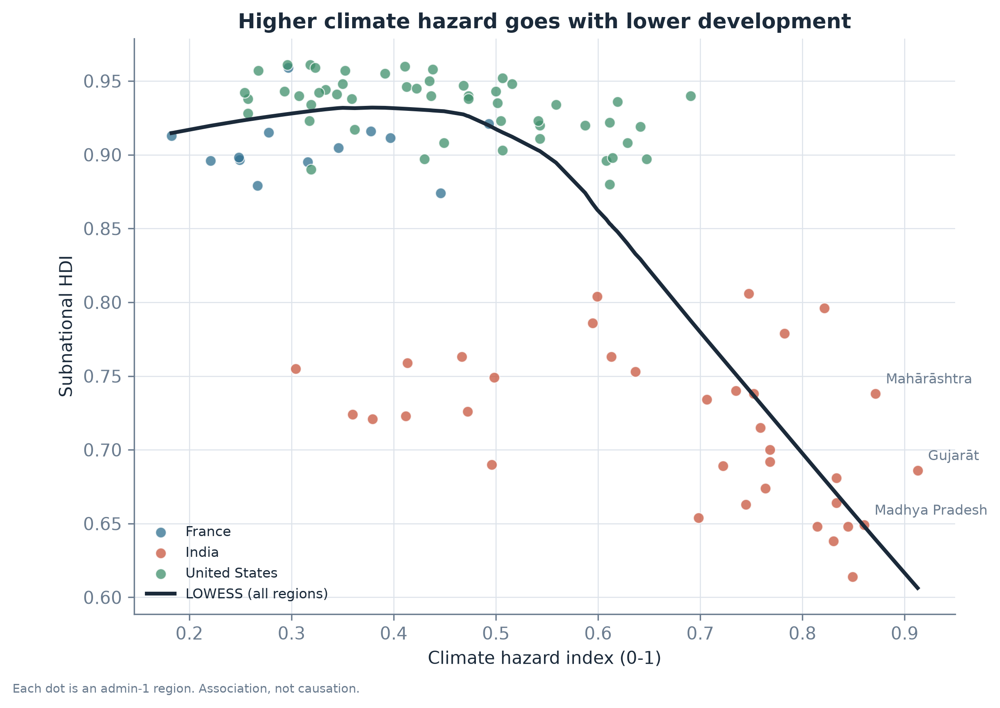

# Climate Risk & Human Development Observatory

[Français](README.md) | **English**

**Are the regions with the most extreme climate also the regions with the lowest human development?**

Project by **Chengho Fongang Marie Louise**.

105 regions in France, India and the United States (1.8 billion people), real public data (NASA,
World Bank, European Commission, Global Data Lab) and three hypotheses tested statistically.

**[Live dashboard](https://climate-risk-observatory.onrender.com)** ·
**[Step-by-step notebook](notebooks/exploration.ipynb)** ·
**[Full report](outputs/report/report.pdf)**



*Each dot is a region. Further right means a more extreme climate; higher up means higher
development.*

---

## Key findings

- **The regions most exposed to climate are less developed.** The median development index is 0.79
  in the more exposed half, compared with 0.94 in the less exposed half.
- **Most of the gap is between countries, not inside them.** When each region is compared only
  with regions of its own country, the link is about four times weaker.
- **Inside countries, the link exists in India and the USA, but not in France.** It is moderate in
  the first two and absent in France (only 13 regions, so the result is uncertain).
- **All ten highest-risk regions are in India**, led by Bihar, Uttar Pradesh and Madhya Pradesh.
- **The ranking is solid.** Three different formulas for the index give at least 9 of the same top
  10 regions.
- **Why it matters:** the index shows where adaptation funding would protect the most vulnerable
  people, both across countries and inside each one.

These are **associations, not causes**.

---

## Skills shown

| Skill | In this project |
|---|---|
| Data collection | 5 public sources through APIs and downloads, with caching and checks (NASA POWER, World Bank, GHS-POP, geoBoundaries, Global Data Lab) |
| Geospatial analysis | Regional polygons, population rasters, climate sample points (GeoPandas, Rasterio, PostGIS) |
| Indicator design | Composite index risk = hazard x exposure x vulnerability, following the IPCC framework |
| Statistics and hypothesis testing | Spearman correlations, regressions with country effects, robustness checks (SciPy, Statsmodels) |
| Visualisation and dashboard | 11 maps, 6 charts, interactive web dashboard (Matplotlib, Plotly Dash) |
| Engineering and quality | Reproducible one-command pipeline, 33 automated tests, 8 data checks, Docker, online deployment |
| Communication | Report in English and French, teaching notebook, limitations explained honestly |

---

## Detailed results

| Hypothesis | Result |
|---|---|
| **H1.** Regions with more climate hazard have a lower SHDI | Yes on all regions: Spearman rho = **-0.59**, median SHDI **0.786** vs **0.936**. But most of it is the gap between India and the two other countries. Inside countries: rho = -0.48 in India, -0.48 in the USA, +0.18 in France (not significant). |
| **H2.** This is still true inside each country | Yes, but smaller: the hazard coefficient goes from **-0.39** to **-0.10** (95% CI -0.14 to -0.06) when we add a country effect. Clear in India and the USA, not in France. |
| **H3.** The ranking is stable when we change the index formula | Yes: the three versions have rank correlations of at least **0.86**, and at least **9 of the top 10** regions are the same. |

Inside their own country, the highest-risk regions are Texas, Alabama and Louisiana (USA) and
Auvergne-Rhône-Alpes, Occitanie and Nouvelle-Aquitaine (France).

**Why highlight -0.10 rather than -0.59?** The correlation on all regions looks the most striking,
but it mostly mixes three very different countries. The coefficient with country effects only
compares regions of the same country: it is the most honest number for a link between climate and
development.

### How the index is built

Each indicator is turned into a **percentile rank** between 0 and 1, so we can mix days,
millimetres and index points.

```
Hazard        = mean(heat, dry, wet)     heat = mean rank of HD35 and TR25
                                         dry  = mean rank of CDD and -WBAL
                                         wet  = mean rank of Rx1day and R50

Exposure      = rank(population)

Vulnerability = 1 - rank(SHDI)

Risk          = Hazard x Exposure x Vulnerability
```

- We use a **product** because, following the IPCC, a region needs all three parts to be at risk:
  a hot desert with nobody living there is not a disaster.
- **Exposure uses population only.** Heat is already in the hazard score; if we also used
  "population x heat days" here, heat would be counted twice.
- Two other versions are used to check the ranking (H3): `additive` (mean of the three scores)
  and `per_person` (hazard x vulnerability, without population, to check that the ranking is not
  only a size effect).
- `rank_in_country` gives the risk rank of each region inside its own country.

### Statistical tests

| Hypothesis | Method | Code |
|---|---|---|
| H1 | Spearman correlation hazard vs SHDI, on all regions and in each country; median SHDI of the more and less hazardous halves | `src/cro/analysis/tests.py` |
| H2 | Linear regression (OLS, HC3 robust errors): M1 `shdi ~ hazard`, M2 `shdi ~ hazard + country dummies`; the same line fitted in each country | `src/cro/analysis/regression.py` |
| H3 | Spearman correlation between the rankings of the three versions + number of shared top-10 regions | `src/cro/analysis/tests.py` |

**Glossary.** *SHDI*: Subnational Human Development Index (health, education, income, from 0 to
1). *Spearman rho*: correlation between two rankings, from -1 to 1. *95% CI*: the range that very
probably contains the true value.

---

## Limitations and next steps

1. **Association, not causation.** History, geography and the economy can explain both climate
   and development.
2. **Neighbouring regions are similar.** The tests treat regions as independent, so the p-values
   are probably too small.
3. **Small sample.** 99 regions with SHDI; France has only 13, so its results are uncertain.
4. **One development indicator.** SHDI does not show inequality inside a region.
5. **Fixed thresholds.** 35 C and 50 mm are choices; France has almost no days above 35 C.
6. **Static population.** Population is for 2020; the climate mean is for 2004-2023.
7. **Coarse sampling.** At most 8 climate points per region.
8. **Pilot countries.** France, India and the USA were chosen because they are different, not
   because they represent the world.

**Next steps**

- Use a spatial regression model, to account for the similarity between neighbours.
- Add more countries: set `project.pilot_iso3` in `config/config.yaml` (for example `["ALL"]`).
- Add a household income indicator to see inequality inside regions.
- Test other heat thresholds (30 C, 40 C).

---

## How to run

```bash
# 1. Environment
python -m venv .venv
.venv\Scripts\activate            # Windows
pip install -e .

# 2. Check that the data sources are reachable
cro probe

# 3. Run the pipeline (downloads ~500 MB once, then uses a cache)
cro all

# 4. Checks, outputs, report
cro validate
cro export
cro report

# 5. Dashboard
cro app            # http://127.0.0.1:8050
```

<details>
<summary>All commands</summary>

| Command | What it does |
|---|---|
| `cro boundaries` | Download admin-1 polygons from geoBoundaries |
| `cro climate-points` | Choose climate sample points inside each region |
| `cro population` | Population per region and per sample point (GHS-POP) |
| `cro climate` | Download daily NASA POWER data and compute the yearly indicators |
| `cro development` | SHDI from Global Data Lab + WDI from the World Bank |
| `cro build` | Build hazard, exposure, vulnerability and the three risk versions |
| `cro analyze` | Descriptive tables, H1 and H3 tests, H2 regressions |
| `cro export` | 11 static maps, 6 figures, 4 interactive maps |
| `cro report` | Build the report tables and render the report (EN + FR) with Quarto |
| `cro validate` | 8 data checks (exit code 1 if one fails) |
| `cro load` | Load the tables into PostGIS |
| `cro app` | Start the Plotly Dash dashboard |
| `cro all` | Run ingest -> build -> analyze -> export in order |

</details>

**Tests:** `pytest -q` (index maths, checks on the real files, dashboard). `cro validate` checks the
data (unique regions, geometry, population totals, physical ranges, scores between 0 and 1, SHDI
coverage).

**Dashboard:** one page with the map, the ranking, the hazard vs SHDI relationship and a profile of
one region; an **EN / FR** switch on every page. It reads PostGIS when it is running and the
Parquet files otherwise. The live version runs on Render's free plan, so the first visit can take
about a minute. Deployment: [docs/deploy.md](docs/deploy.md).

**PostGIS (optional):** `docker compose up -d` then `cro load` creates a star schema
(`dim_region`, `fact_climate`, `fact_risk`...) and the view `vw_region_profile` on port 5433.

---

## Files

```
config/config.yaml              all settings (countries, thresholds, years)
src/cro/ingest/                 download boundaries, climate, population, development
src/cro/features/build.py       hazard, exposure, vulnerability, risk versions
src/cro/analysis/               descriptive tables, H1/H3 tests, H2 regression
src/cro/viz/                    shared theme, static maps, charts, interactive maps
src/cro/app/                    Dash dashboard + summary and report pages
src/cro/db/                     PostGIS schema and loader
src/cro/report/                 report tables + Quarto rendering
report/                         report.qmd / report.fr.qmd
notebooks/exploration.ipynb     step-by-step walkthrough of the results (uses src/cro)
notebooks/exploration.fr.ipynb  the same walkthrough in French
tests/                          unit tests, data checks, dashboard tests
outputs/maps|figures|tables/    results (maps, charts, CSV tables)
outputs/report/                 report(.fr).html/.pdf, key_results.md, validation.md
```

`data/processed/region_master.parquet` is the one table that every output reads, so the maps,
the tables, the report and the dashboard always agree.

---

## Data sources and licences

| Layer | Source | Resolution | Year | Licence |
|---|---|---|---|---|
| Boundaries | [geoBoundaries](https://www.geoboundaries.org/) (gbOpen) | admin-1 polygons | 2024 release | CC-BY 4.0 |
| Climate | [NASA POWER](https://power.larc.nasa.gov/) (MERRA-2) | daily point series | 1991-2023 | Open, no key |
| Population | [GHS-POP R2023A](https://ghsl.jrc.ec.europa.eu/) | ~1 km | 2020 | CC-BY 4.0 |
| Development | [Global Data Lab SHDI](https://globaldatalab.org/shdi/) | admin-1 | latest available | Free for research |
| National context | [World Bank WDI](https://databank.worldbank.org/source/world-development-indicators) | country | 2010-2023 | CC-BY 4.0 |

NASA POWER does not give evapotranspiration, so we estimate it with the Hargreaves formula
(Hargreaves & Samani, 1985) from daily minimum/maximum temperature and latitude.

### Key references

The full list is in the report.

- **Risk = hazard x exposure x vulnerability:** Cardona et al. (2012), IPCC SREX chapter 2; IPCC (2014), AR5 WGII.
- **Multiplicative risk index:** Marin-Ferrer, Vernaccini & Poljansek (2017), INFORM methodology (European Commission JRC).
- **Rank normalisation and robustness checks:** Nardo et al. (2008), OECD/JRC *Handbook on Constructing Composite Indicators*; Saisana, Saltelli & Tarantola (2005), *JRSS A* 168(2).
- **Climate extreme indicators:** Zhang et al. (2011), *WIREs Climate Change* 2(6).
- **Climate and income inside countries:** Dell, Jones & Olken (2009), *American Economic Review* 99(2); Nordhaus (2006), *PNAS* 103(10).
- **Subnational HDI:** Smits & Permanyer (2019), *Scientific Data* 6.
