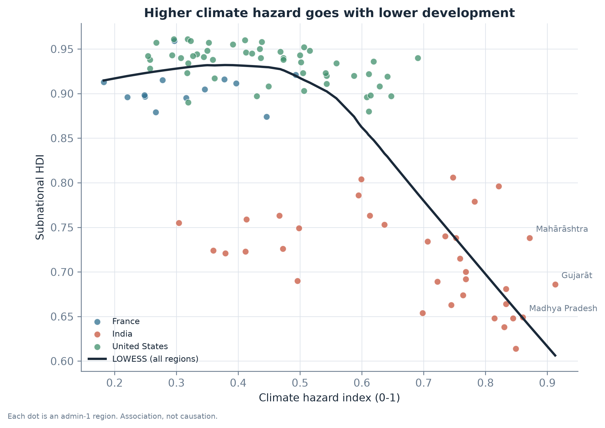

# Observatoire du risque climatique et du développement humain

**Français** | [English](README.en.md)

**Les régions au climat le plus extrême sont-elles aussi les régions où le développement humain est le plus faible ?**

Projet réalisé par **Chengho Fongang Marie Louise**.

105 régions en France, en Inde et aux États-Unis (1,8 milliard d'habitants), des données publiques
réelles (NASA, Banque mondiale, Commission européenne, Global Data Lab) et trois hypothèses
testées statistiquement.

**[Tableau de bord en ligne](https://climate-risk-observatory.onrender.com)** ·
**[Notebook pas à pas](notebooks/exploration.fr.ipynb)** ·
**[Rapport complet](outputs/report/report.fr.pdf)**



*Chaque point est une région. Plus on va à droite, plus le climat est extrême ; plus on monte, plus
le développement est élevé.*

---

## Principaux résultats

- **Les régions les plus exposées au climat sont moins développées.** L'indice de développement
  médian est de 0,79 dans la moitié la plus exposée, contre 0,94 dans la moitié la moins exposée.
- **L'essentiel de l'écart se situe entre les pays, pas à l'intérieur.** Quand on compare chaque
  région uniquement à celles de son propre pays, le lien est environ quatre fois plus faible.
- **À l'intérieur des pays, le lien existe en Inde et aux États-Unis, mais pas en France.** Il est
  de force moyenne dans les deux premiers et absent en France (seulement 13 régions, donc un résultat incertain).
- **Les dix régions les plus à risque sont toutes en Inde**, avec en tête le Bihar, l'Uttar Pradesh
  et le Madhya Pradesh.
- **Le classement est solide.** Trois formules différentes de l'indice donnent au moins 9 des 10
  mêmes régions en tête.
- **Utilité concrète :** l'indice indique où les financements d'adaptation protégeraient le plus
  de personnes vulnérables, entre pays comme au sein d'un même pays.

Ce sont des **associations, pas des causes**.

---

## Compétences mobilisées

| Compétence | Dans ce projet |
|---|---|
| Collecte de données | 5 sources publiques via API et téléchargements, avec cache et contrôles (NASA POWER, Banque mondiale, GHS-POP, geoBoundaries, Global Data Lab) |
| Analyse géospatiale | Polygones régionaux, rasters de population, points d'échantillonnage climatique (GeoPandas, Rasterio, PostGIS) |
| Construction d'indicateurs | Indice composite risque = aléa x exposition x vulnérabilité, suivant le cadre du GIEC |
| Statistiques et tests d'hypothèses | Corrélations de Spearman, régressions avec effets pays, tests de robustesse (SciPy, Statsmodels) |
| Visualisation et tableau de bord | 11 cartes, 6 graphiques, tableau de bord web interactif (Matplotlib, Plotly Dash) |
| Ingénierie et qualité | Chaîne de traitement reproductible en une commande, 33 tests automatisés, 8 contrôles de données, Docker, déploiement en ligne |
| Communication | Rapport en français et en anglais, notebook pédagogique, limites expliquées honnêtement |

---

## Résultats détaillés

| Hypothèse | Résultat |
|---|---|
| **H1.** Les régions les plus exposées aux aléas climatiques ont un SHDI plus faible | Oui sur l'ensemble des régions : rho de Spearman = **-0,59**, SHDI médian **0,786** contre **0,936**. Mais l'essentiel vient de l'écart entre l'Inde et les deux autres pays. À l'intérieur des pays : rho = -0,48 en Inde, -0,48 aux États-Unis, +0,18 en France (non significatif). |
| **H2.** C'est encore vrai à l'intérieur de chaque pays | Oui, mais l'effet est plus faible : le coefficient de l'aléa passe de **-0,39** à **-0,10** (IC à 95 % : -0,14 à -0,06) quand on ajoute un effet pays. Net en Inde et aux États-Unis, absent en France. |
| **H3.** Le classement est stable quand on change la formule de l'indice | Oui : les trois versions ont des corrélations de rang d'au moins **0,86**, et au moins **9 des 10** premières régions sont les mêmes. |

Au sein de leur propre pays, les régions les plus à risque sont le Texas, l'Alabama et la
Louisiane (États-Unis) et l'Auvergne-Rhône-Alpes, l'Occitanie et la Nouvelle-Aquitaine (France).

**Pourquoi mettre en avant -0,10 plutôt que -0,59 ?** La corrélation sur toutes les régions est
la plus spectaculaire, mais elle mélange surtout trois pays très différents. Le coefficient avec
effets pays ne compare que des régions d'un même pays : c'est le chiffre le plus honnête pour
parler d'un lien entre climat et développement.

### Construction de l'indice

Chaque indicateur est transformé en **rang centile** entre 0 et 1, ce qui permet de combiner des
jours, des millimètres et des points d'indice.

```
Aléa           = moyenne(chaleur, sécheresse, humidité)
                 chaleur    = rang moyen de HD35 et TR25
                 sécheresse = rang moyen de CDD et -WBAL
                 humidité   = rang moyen de Rx1day et R50

Exposition     = rang(population)

Vulnérabilité  = 1 - rang(SHDI)

Risque         = Aléa x Exposition x Vulnérabilité
```

- Nous utilisons un **produit** car, suivant le GIEC, une région doit réunir les trois composantes
  pour être à risque : un désert brûlant où personne ne vit n'est pas une catastrophe.
- **L'exposition ne repose que sur la population.** La chaleur est déjà dans le score d'aléa ; si
  nous utilisions aussi « population x jours de chaleur » ici, la chaleur serait comptée deux fois.
- Deux autres versions servent à vérifier le classement (H3) : `additive` (moyenne des trois
  scores) et `per_person` (aléa x vulnérabilité, sans la population, pour vérifier que le classement
  n'est pas seulement un effet de taille).
- `rank_in_country` donne le rang de risque de chaque région au sein de son propre pays.

### Tests statistiques

| Hypothèse | Méthode | Code |
|---|---|---|
| H1 | Corrélation de Spearman aléa / SHDI, sur toutes les régions et par pays ; SHDI médian de la moitié la plus exposée et de la moitié la moins exposée | `src/cro/analysis/tests.py` |
| H2 | Régression linéaire (MCO, erreurs robustes HC3) : M1 `shdi ~ hazard`, M2 `shdi ~ hazard + indicatrices pays` ; la même droite ajustée dans chaque pays | `src/cro/analysis/regression.py` |
| H3 | Corrélation de Spearman entre les classements des trois versions + nombre de régions communes dans le top 10 | `src/cro/analysis/tests.py` |

**Vocabulaire.** *SHDI* : indice de développement humain infranational (santé, éducation, revenu,
de 0 à 1). *rho de Spearman* : corrélation entre deux classements, de -1 à 1. *IC à 95 %* :
fourchette dans laquelle se trouve très probablement la vraie valeur.

---

## Limites et prochaines étapes

1. **Association, pas causalité.** L'histoire, la géographie et l'économie peuvent expliquer à la
   fois le climat et le développement.
2. **Les régions voisines se ressemblent.** Les tests traitent les régions comme indépendantes : les
   p-valeurs sont donc probablement trop petites.
3. **Petit échantillon.** 99 régions ont un SHDI ; la France n'en compte que 13, ses résultats sont
   donc incertains.
4. **Un seul indicateur de développement.** Le SHDI ne montre pas les inégalités à l'intérieur
   d'une région.
5. **Seuils fixes.** 35 °C et 50 mm sont des choix ; la France n'a presque aucun jour au-dessus de
   35 °C.
6. **Population statique.** La population est celle de 2020 ; la moyenne climatique porte sur
   2004-2023.
7. **Échantillonnage grossier.** Au plus 8 points climatiques par région.
8. **Pays pilotes.** La France, l'Inde et les États-Unis ont été choisis parce qu'ils sont
   différents, pas parce qu'ils représentent le monde.

**Prochaines étapes**

- Utiliser un modèle de régression spatiale, pour tenir compte de la ressemblance entre voisins.
- Ajouter des pays : modifier `project.pilot_iso3` dans `config/config.yaml` (par exemple `["ALL"]`).
- Ajouter un indicateur de revenu des ménages pour voir les inégalités à l'intérieur des régions.
- Tester d'autres seuils de chaleur (30 °C, 40 °C).

---

## Lancer le projet

```bash
# 1. Environnement
python -m venv .venv
.venv\Scripts\activate            # Windows
pip install -e .

# 2. Vérifier que les sources de données sont accessibles
cro probe

# 3. Lancer la chaîne de traitement (télécharge ~500 Mo une fois, puis utilise un cache)
cro all

# 4. Contrôles, sorties, rapport
cro validate
cro export
cro report

# 5. Tableau de bord
cro app            # http://127.0.0.1:8050
```

<details>
<summary>Toutes les commandes</summary>

| Commande | Rôle |
|---|---|
| `cro boundaries` | Télécharge les polygones admin-1 depuis geoBoundaries |
| `cro climate-points` | Choisit les points d'échantillonnage climatique dans chaque région |
| `cro population` | Population par région et par point d'échantillonnage (GHS-POP) |
| `cro climate` | Télécharge les données journalières NASA POWER et calcule les indicateurs annuels |
| `cro development` | SHDI de Global Data Lab + WDI de la Banque mondiale |
| `cro build` | Construit l'aléa, l'exposition, la vulnérabilité et les trois versions du risque |
| `cro analyze` | Tableaux descriptifs, tests H1 et H3, régressions H2 |
| `cro export` | 11 cartes statiques, 6 figures, 4 cartes interactives |
| `cro report` | Construit les tableaux du rapport et génère le rapport (FR + EN) avec Quarto |
| `cro validate` | 8 contrôles de données (code de sortie 1 si l'un échoue) |
| `cro load` | Charge les tables dans PostGIS |
| `cro app` | Lance le tableau de bord Plotly Dash |
| `cro all` | Enchaîne ingestion -> construction -> analyse -> export |

</details>

**Tests :** `pytest -q` (calculs de l'indice, contrôles sur les fichiers réels, tableau de bord).
`cro validate` vérifie les données (unicité des régions, géométries, totaux de population, plages
physiques, scores entre 0 et 1, couverture du SHDI).

**Tableau de bord :** une page avec la carte, le classement, la relation aléa / SHDI et la fiche
d'une région ; bouton **EN / FR** sur chaque page. Il lit PostGIS s'il est lancé, sinon les
fichiers Parquet. La version en ligne est sur l'offre gratuite de Render : la première visite peut
prendre environ une minute. Déploiement : [docs/deploy.md](docs/deploy.md).

**PostGIS (facultatif) :** `docker compose up -d` puis `cro load` crée un schéma en étoile
(`dim_region`, `fact_climate`, `fact_risk`...) et la vue `vw_region_profile` sur le port 5433.

---

## Fichiers

```
config/config.yaml              tous les paramètres (pays, seuils, années)
src/cro/ingest/                 téléchargement des limites, du climat, de la population, du développement
src/cro/features/build.py       aléa, exposition, vulnérabilité, versions du risque
src/cro/analysis/               tableaux descriptifs, tests H1/H3, régression H2
src/cro/viz/                    thème commun, cartes statiques, graphiques, cartes interactives
src/cro/app/                    tableau de bord Dash + pages résumé et rapport
src/cro/db/                     schéma PostGIS et chargement
src/cro/report/                 tableaux du rapport + génération Quarto
report/                         report.fr.qmd / report.qmd
notebooks/exploration.fr.ipynb  présentation pas à pas des résultats (en français)
notebooks/exploration.ipynb     la même présentation en anglais
tests/                          tests unitaires, contrôles de données, tests du tableau de bord
outputs/maps|figures|tables/    résultats (cartes, graphiques, tables CSV)
outputs/report/                 report(.fr).html/.pdf, key_results.md, validation.md
```

`data/processed/region_master.parquet` est l'unique table lue par toutes les sorties : les cartes,
les tableaux, le rapport et le tableau de bord sont donc toujours cohérents.

---

## Sources de données et licences

| Couche | Source | Résolution | Année | Licence |
|---|---|---|---|---|
| Limites administratives | [geoBoundaries](https://www.geoboundaries.org/) (gbOpen) | polygones admin-1 | version 2024 | CC-BY 4.0 |
| Climat | [NASA POWER](https://power.larc.nasa.gov/) (MERRA-2) | séries journalières ponctuelles | 1991-2023 | Libre, sans clé |
| Population | [GHS-POP R2023A](https://ghsl.jrc.ec.europa.eu/) | ~1 km | 2020 | CC-BY 4.0 |
| Développement | [Global Data Lab SHDI](https://globaldatalab.org/shdi/) | admin-1 | dernière année disponible | Libre pour la recherche |
| Contexte national | [Banque mondiale WDI](https://databank.worldbank.org/source/world-development-indicators) | pays | 2010-2023 | CC-BY 4.0 |

NASA POWER ne fournit pas l'évapotranspiration ; nous l'estimons avec la formule de Hargreaves
(Hargreaves et Samani, 1985) à partir des températures minimale et maximale journalières et de la
latitude.

### Références principales

La liste complète figure dans le rapport.

- **Risque = aléa x exposition x vulnérabilité :** Cardona et al. (2012), GIEC SREX chapitre 2 ; GIEC (2014), AR5 GT II.
- **Indice de risque multiplicatif :** Marin-Ferrer, Vernaccini et Poljansek (2017), méthodologie INFORM (Centre commun de recherche de la Commission européenne).
- **Normalisation par les rangs et tests de robustesse :** Nardo et al. (2008), OCDE/CCR *Handbook on Constructing Composite Indicators* ; Saisana, Saltelli et Tarantola (2005), *JRSS A* 168(2).
- **Indicateurs d'extrêmes climatiques :** Zhang et al. (2011), *WIREs Climate Change* 2(6).
- **Climat et revenu à l'intérieur des pays :** Dell, Jones et Olken (2009), *American Economic Review* 99(2) ; Nordhaus (2006), *PNAS* 103(10).
- **IDH infranational :** Smits et Permanyer (2019), *Scientific Data* 6.
