```{=html}
<style>
.callout-note { border-left: 4px solid #2f6f8f; background: #f2f7fa; padding: 10px 14px; margin: 14px 0; }
.callout-warn { border-left: 4px solid #c8553d; background: #fdf4f2; padding: 10px 14px; margin: 14px 0; }
.small { font-size: 0.9em; color: #4a5a6a; }
</style>
```


## Résumé {.unnumbered}

Ce projet pose une question simple : **les régions où le climat est le plus extrême sont-elles aussi celles où le développement humain est le plus faible ?** Nous y répondons pour 105 régions admin-1 (États, provinces et régions) en France, en Inde et aux États-Unis, soit 1,8 milliard de personnes.

Nous construisons un pipeline Python qui télécharge des données ouvertes, calcule un indice de risque climatique pour chaque région, teste trois hypothèses, et présente les résultats sous forme de cartes, d'un rapport et d'un tableau de bord web.

Les principaux résultats sont :

1. **H1 - Plus d'aléa, moins de développement.** Sur toutes les régions, la corrélation de Spearman entre l'indice d'aléa climatique et l'indice de développement humain infranational (IDH-S) est de −0,59. Mais elle vient surtout de la différence entre l'Inde et les deux autres pays.
2. **H2 - Le lien est plus faible à l'intérieur des pays, mais il existe.** Quand on ajoute un effet pays à la régression, le coefficient de l'aléa passe de −0,39 à −0,10. Le lien est net en Inde et aux États-Unis, absent en France.
3. **H3 - Le classement est stable.** Trois versions différentes de l'indice donnent presque le même top 10. Les dix régions les plus à risque sont toutes en Inde.

Ces résultats sont des **associations, pas des causes**.



## Abréviations {.unnumbered}

| Abréviation | Signification |
|---|---|
| admin-1 | premier niveau de régions dans un pays (États, provinces, régions) |
| CC-BY | licence Creative Commons Attribution (usage libre si on cite la source) |
| CDD | *Consecutive Dry Days* : plus longue suite de jours avec moins de 1 mm de pluie |
| CRS / EPSG:4326 | système de coordonnées ; EPSG:4326 = latitude/longitude (WGS 84) |
| CSV | fichier de tableau simple (valeurs séparées par des virgules) |
| ETCCDI | équipe d'experts sur la détection du changement climatique et les indices (indices standards d'extrêmes climatiques) |
| FRA, IND, USA | codes ISO à 3 lettres de la France, de l'Inde et des États-Unis |
| GHS-POP | *Global Human Settlement Layer* - grille de population (Commission européenne) |
| GIEC | Groupe d'experts intergouvernemental sur l'évolution du climat (IPCC en anglais) |
| H1, H2, H3 | les trois hypothèses testées dans ce rapport |
| HC3 | type d'erreur-type robuste pour les régressions |
| HD35 | *Heat Days* : jours avec une température maximale de 35 °C ou plus |
| IC | intervalle de confiance (ici à 95 %) |
| IDH-S | indice de développement humain infranational (SHDI en anglais, Global Data Lab) |
| INFORM | *Index for Risk Management* : indice de gestion des risques (Commission européenne) |
| JRC | Centre commun de recherche de la Commission européenne |
| M1, M2 | les deux modèles de régression (sans et avec effets pays) |
| MCO | moindres carrés ordinaires (régression linéaire, OLS en anglais) |
| MERRA-2 | réanalyse climatique de la NASA, version 2 |
| N | nombre d'observations (régions) |
| NASA POWER | *Prediction Of Worldwide Energy Resources* : données climatiques quotidiennes de la NASA |
| OCDE | Organisation de coopération et de développement économiques |
| p | p-valeur : probabilité d'obtenir un résultat au moins aussi fort s'il n'y avait aucun lien réel |
| R² | part de la variation de l'IDH-S expliquée par le modèle |
| R50 | jours avec plus de 50 mm de pluie |
| Rx1day | plus forte pluie en un jour dans l'année |
| rho | corrélation de rang de Spearman, de −1 à +1 |
| TR25 | nuits tropicales : nuits avec une température minimale de 25 °C ou plus |
| WBAL | bilan hydrique : pluie moins évapotranspiration |
| WDI | *World Development Indicators* (Banque mondiale) |

## Introduction

### Contexte

On parle souvent du risque climatique pays par pays. Mais un pays n'est pas homogène : en Inde, le Rajasthan compte environ 170 jours au-dessus de 35 °C par an, alors que le Kerala n'en a presque aucun. Le développement humain change aussi beaucoup à l'intérieur d'un pays. Pour savoir où l'aide est la plus utile, il faut travailler à une échelle plus fine. Des études montrent pourquoi : Nordhaus (2006) a trouvé que le climat et la géographie expliquent une grande partie de la production économique quand on la mesure sur une grille fine plutôt que par pays, et Dell, Jones et Olken (2009) ont montré que le lien négatif entre température et revenu existe aussi *à l'intérieur* des pays. Les chocs climatiques touchent aussi plus fortement les personnes qui ont moins de ressources (Hallegatte et al., 2016), et les fortes chaleurs réduisent la production économique (Burke, Hsiang et Miguel, 2015).

Nous travaillons au **niveau admin-1** (États, provinces, régions). C'est le plus petit niveau où les données de climat, de population et de développement sont toutes disponibles gratuitement.

### Question de recherche et hypothèses

> Les régions où le climat est le plus extrême sont-elles aussi celles où le développement humain est le plus faible ?

Nous testons trois hypothèses :

- **H1.** Les régions avec un aléa climatique plus élevé ont un IDH-S plus faible.
- **H2.** C'est encore vrai quand on compare les régions d'un même pays.
- **H3.** Le classement du risque change peu quand on change la façon de construire l'indice.

H2 est importante. L'Inde a un climat plus chaud et un IDH-S moyen plus faible que la France et les États-Unis : une corrélation sur toutes les régions pourrait seulement dire « l'Inde est différente ». Comparer les régions d'un même pays est un test plus juste. Les économistes débattent depuis longtemps pour savoir si le lien entre géographie et revenu vient du climat lui-même (Gallup, Sachs et Mellinger, 1999) ou de l'histoire et des institutions (Acemoglu, Johnson et Robinson, 2002). Comparer des régions d'un même pays garde les mêmes institutions nationales : c'est l'approche de Dell, Jones et Olken (2009).

### Périmètre

Le pilote couvre trois pays, choisis parce qu'ils sont très différents : la France (revenu élevé, climat tempéré, petite), les États-Unis (revenu élevé, très grands, nombreux climats) et l'Inde (revenu intermédiaire inférieur, climat chaud, très grande population). Le code peut tourner sur d'autres pays en changeant une ligne dans `config/config.yaml`.

::: {.callout-warn}
**Ce que ce rapport n'affirme pas.** Tous les résultats sont des associations. Nous ne prouvons pas que le climat cause un faible développement. L'histoire, la géographie et les institutions peuvent expliquer les deux.
:::

## Données

### Sources

| Couche | Source | Résolution | Années | Licence |
|---|---|---|---|---|
| Limites des régions | geoBoundaries (gbOpen) | polygones admin-1 | version 2024 | CC-BY 4.0 |
| Climat quotidien | NASA POWER (MERRA-2) | points | 1991-2023 | Ouverte, sans clé |
| Population | GHS-POP R2023A | grille ~1 km | 2020 | CC-BY 4.0 |
| Développement | Global Data Lab IDH-S | admin-1 | dernière année | Libre pour la recherche |
| Contexte national | Banque mondiale WDI | pays | 2010-2023 | CC-BY 4.0 |

### Données climatiques

NASA POWER fournit une série quotidienne par point. Ses données viennent de la réanalyse MERRA-2 de la NASA (Gelaro et al., 2017). Dans chaque région, nous choisissons entre 1 et 8 points (un point pour 40 000 km²), répartis sur toute la région. Cela donne **308 points** au total. Pour chaque point, nous téléchargeons tous les jours de 1991 à 2023.

À partir des données quotidiennes, nous calculons six indicateurs par an, puis la moyenne sur 2004-2023. Ils suivent la logique des indices standards d'extrêmes climatiques de l'équipe d'experts ETCCDI (Zhang et al., 2011), avec des seuils choisis pour le stress thermique et les fortes pluies :

| Code | Indicateur | Groupe |
|---|---|---|
| HD35 | jours avec une température maximale de 35 °C ou plus | chaleur |
| TR25 | nuits avec une température minimale de 25 °C ou plus | chaleur |
| CDD | plus longue suite de jours avec moins de 1 mm de pluie | sec |
| WBAL | pluie moins évapotranspiration (formule de Hargreaves) | sec |
| Rx1day | plus forte pluie en un jour | humide |
| R50 | jours avec plus de 50 mm de pluie | humide |



Une vérification rapide : le Rajasthan (désert) a 169 jours de chaleur par an et le Kerala (côte de mousson) en a 0. C'est ce qu'on attend : les données semblent correctes.

### Population

GHS-POP donne le nombre d'habitants de chaque case de 1 km. Nous additionnons les cases de chaque région. Nous rattachons aussi chaque personne au point climatique le plus proche. Les deux totaux sont presque égaux (1 803,1 millions contre 1 805,5 millions, soit 0,1 % d'écart). Avec ces deux éléments, nous calculons aussi les *jours-personnes de chaleur extrême* (habitants × jours chauds), une mesure utilisée dans les études sur l'exposition à la chaleur (Tuholske et al., 2021). Elle apparaît dans le tableau 1 comme information en plus, mais elle n'est pas utilisée dans l'indice de risque.

### Développement

L'IDH-S vient du Global Data Lab (Smits et Permanyer, 2019). Il est calculé comme l'indice de développement humain national (santé, éducation et revenu), mais pour les régions. Ses noms de régions ne sont pas toujours les mêmes que dans geoBoundaries (par exemple *Odisha* / *Orissa*). Nous avons associé les noms en trois étapes : correspondance exacte, une courte liste manuelle, puis correspondance approximative. **99 des 105 régions** ont un IDH-S. Les 6 autres (le Ladakh et cinq petits territoires américains) restent sur les cartes climatiques mais ne sont pas utilisées dans les tests. Nous ne les remplaçons pas par la moyenne du pays, car cela créerait de fausses données.

## Méthode

### L'indice de risque

Nous suivons l'idée du GIEC : le risque vient de la rencontre entre un **aléa**, des personnes **exposées** et leur **vulnérabilité** (Cardona et al., 2012 ; IPCC, 2014). Chaque partie est un score entre 0 et 1.

Pour construire chaque score, nous utilisons des **rangs centiles** : la région avec la valeur la plus basse a un score proche de 0, et celle avec la valeur la plus haute a 1. Les rangs permettent de mélanger des jours, des millimètres et des indices, et une région extrême n'écrase pas toutes les autres. La normalisation par les rangs est une des méthodes standards décrites dans le manuel OCDE/JRC sur les indicateurs composites (Nardo et al., 2008).

L'**aléa** est la moyenne de trois sous-scores :

```
Aléa = (H_chaleur + H_sec + H_humide) / 3
```

`H_chaleur` est le rang moyen de HD35 et TR25, `H_sec` celui de CDD et de WBAL (inversé), et `H_humide` celui de Rx1day et R50.

L'**exposition** est le rang de la population de la région. Nous ne multiplions pas la population par les jours de chaleur, car la chaleur est déjà dans l'aléa : elle serait comptée deux fois.

La **vulnérabilité** vaut `1 - rang(IDH-S)`. Un faible développement signifie moins d'argent, de santé et d'éducation pour faire face à un choc climatique.

Le **risque** est le produit des trois :

```
Risque = Aléa x Exposition x Vulnérabilité
```

Nous utilisons un produit car une région a besoin des trois pour être à risque : un désert chaud sans habitants n'est pas une catastrophe. L'indice de risque INFORM de la Commission européenne combine aussi ses parties par multiplication, pour que le risque soit nul quand une partie est nulle (Marin-Ferrer, Vernaccini et Poljansek, 2017).

### Trois versions de l'indice

| Version | Formule | Pourquoi |
|---|---|---|
| `equal` (principale) | Aléa × Exposition × Vulnérabilité | le résultat principal |
| `additive` | moyenne des trois scores | le produit change-t-il quelque chose ? |
| `per_person` | Aléa × Vulnérabilité | sans la population : le classement est-il seulement un effet de taille ? |

Tester plusieurs versions d'un indice est une pratique recommandée, car les poids et la formule sont des choix (Saisana, Saltelli et Tarantola, 2005 ; Nardo et al., 2008). La version `per_person` est utile car les grandes régions ont toujours un score d'exposition élevé. Si les premières régions restent les mêmes sans la population, le classement ne dépend pas seulement de la taille.

### Tests statistiques

- **H1 :** corrélation de rang de Spearman entre l'aléa et l'IDH-S, sur toutes les régions puis pays par pays. Nous utilisons Spearman (1904) car il travaille sur les rangs et n'a pas besoin d'une loi normale. Nous comparons aussi l'IDH-S médian de la moitié la plus exposée et de la moitié la moins exposée.
- **H2 :** deux régressions linéaires (MCO) avec l'IDH-S comme variable expliquée :
  - M1 : `IDH-S = a + b x Aléa`
  - M2 : la même chose, plus une variable indicatrice par pays (« effet pays »).

  Les indicatrices pays enlèvent la différence moyenne entre les pays : dans M2, `b` utilise seulement les différences entre régions d'un même pays. Nous estimons aussi M1 dans chaque pays séparément. Nous utilisons des erreurs-types robustes (HC3) : elles restent correctes quand la variance des erreurs n'est pas la même pour toutes les régions, et elles sont recommandées pour les petits échantillons (Long et Ervin, 2000).
- **H3 :** corrélation de Spearman entre les classements des trois versions, et nombre de régions présentes dans le top 10 des deux versions.

Nous utilisons un seuil de significativité de 5 %.

## Résultats : les cartes

### Aléa

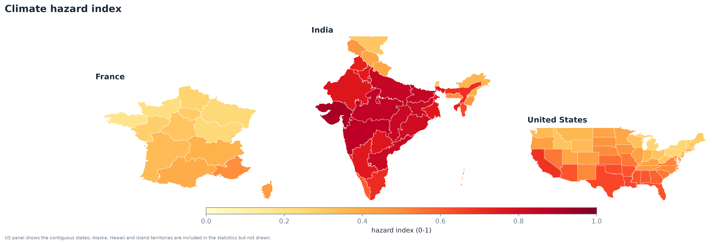

L'Inde a l'aléa le plus élevé (moyenne 0,67), puis les États-Unis (0,45) et la France (0,32). Aux États-Unis, le sud et le sud-ouest sont beaucoup plus exposés que le nord-est.

### Exposition et développement

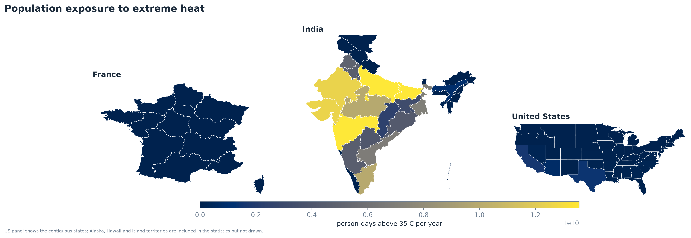

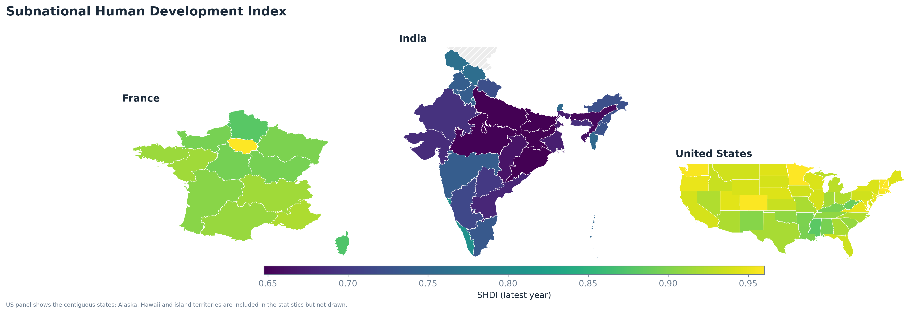

L'IDH-S va de 0,614 (Bihar) à 0,961 (meilleurs États américains). L'Inde va de 0,61 à 0,81, les États-Unis de 0,88 à 0,96 et la France de 0,87 à 0,96. Les écarts à l'intérieur de l'Inde sont plus grands que l'écart entre les États-Unis et la France.



### Risque

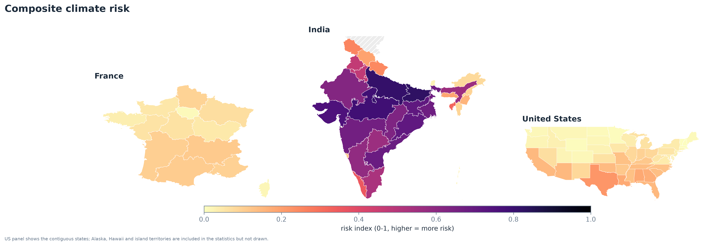



Les dix régions les plus à risque sont toutes en Inde. Le Bihar, l'Uttar Pradesh et le Madhya Pradesh sont chauds, très peuplés et ont un IDH-S faible. Sur cette échelle commune, la France et les États-Unis paraissent pâles. À l'intérieur de leur propre pays, les régions les plus à risque sont le Texas, l'Alabama et la Louisiane aux États-Unis, et Auvergne-Rhône-Alpes, l'Occitanie et la Nouvelle-Aquitaine en France (voir la figure ci-dessous et la colonne `rank_in_country`).

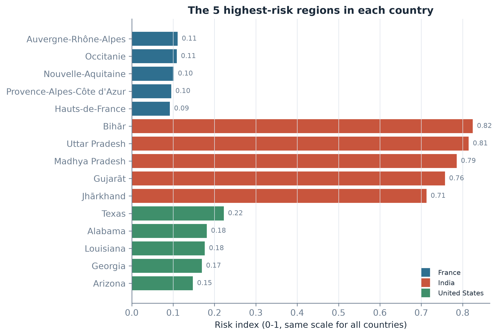

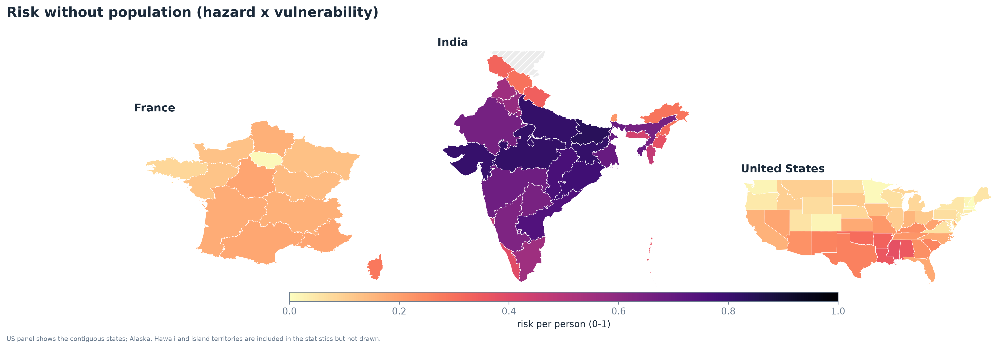

La carte sans la population est très proche. De petits États indiens comme le Tripura montent, mais les grands États du nord et du centre restent en tête.

### Aléa élevé et faible développement ensemble

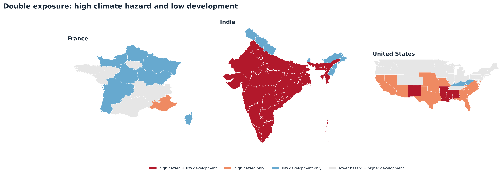

Nous coupons l'aléa et la vulnérabilité à leur médiane. 33 régions sont au-dessus des deux médianes : 28 en Inde et 5 aux États-Unis, aucune en France. Ce sont les régions où l'adaptation est la plus urgente.

## Résultats : les hypothèses

### H1 : plus d'aléa, moins de développement



Sur toutes les régions, la corrélation est de −0,59 et très significative. L'IDH-S médian est de 0,786 dans la moitié la plus exposée et de 0,936 dans l'autre moitié.

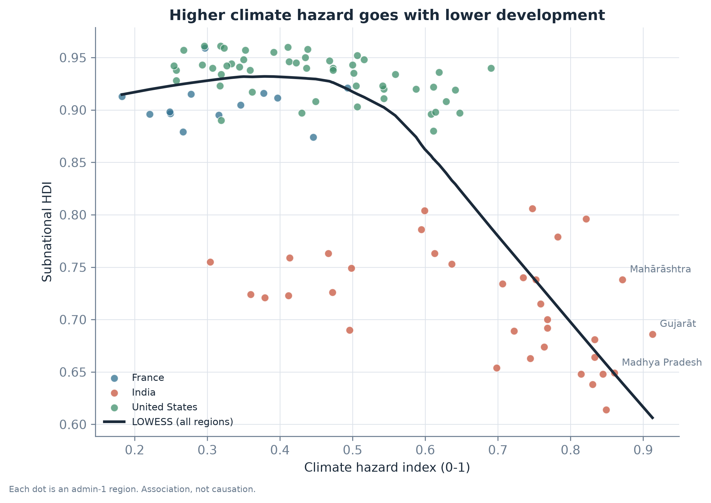

La figure montre pourquoi il faut être prudent. Les points forment **trois groupes** : l'Inde en bas à droite, les États-Unis et la France en haut. Une grande partie de la corrélation est simplement l'écart entre l'Inde et les deux autres pays. À l'intérieur de chaque pays, la corrélation est plus faible : −0,48 en Inde et aux États-Unis (toutes deux significatives), et +0,18 en France (non significative).

**H1 est confirmée**, mais surtout à cause de la différence entre les pays.

### H2 : est-ce encore vrai à l'intérieur des pays ?



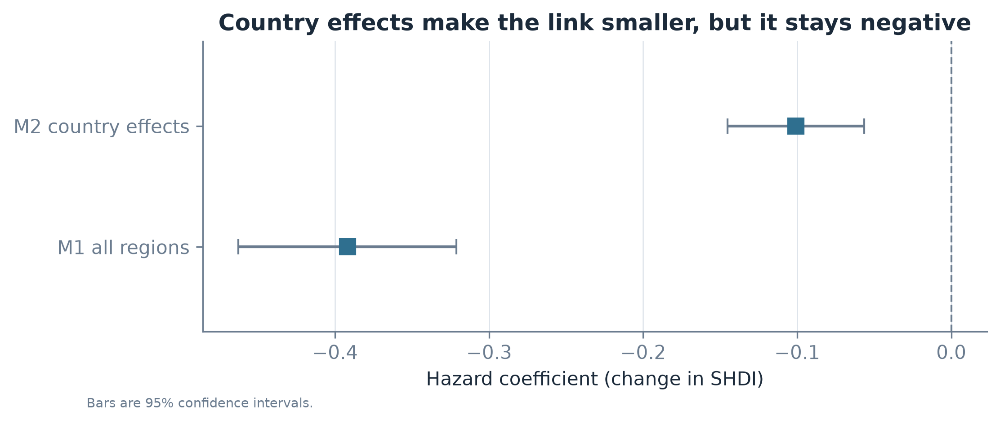

Comment lire le coefficient : l'aléa va de 0 à 1, donc le coefficient est la variation de l'IDH-S entre la région la moins exposée et la plus exposée.

- Sans effets pays (M1), le coefficient vaut −0,39.
- Avec effets pays (M2), il descend à **−0,10** (IC à 95 % : −0,14 à −0,06). Autrement dit : dans un même pays, +0,1 d'aléa va avec environ −0,01 d'IDH-S.

Environ trois quarts du lien viennent donc des différences entre pays, et un quart reste à l'intérieur des pays.



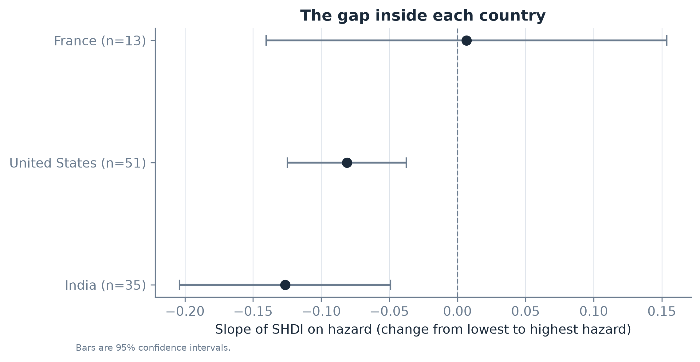

La pente est négative et significative en Inde et aux États-Unis, et proche de zéro en France. La France n'a que 13 régions et peu de différences de climat : on ne peut rien conclure pour elle.

**H2 est confirmée** pour l'Inde et les États-Unis, avec un effet plus faible que pour H1.

### H3 : le classement est-il stable ?



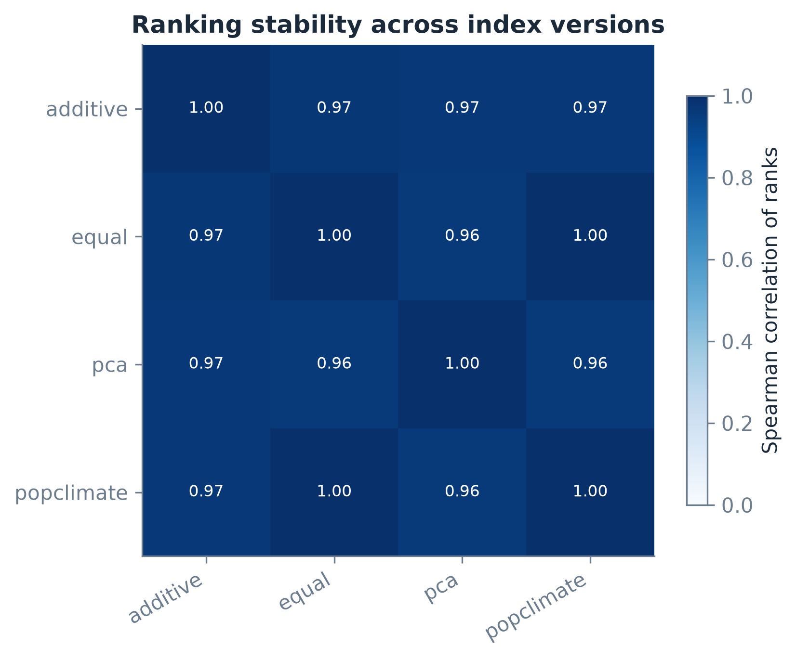

Les trois versions sont fortement corrélées (corrélation de Spearman d’au moins 0,86), et au moins 9 des 10 premières régions sont les mêmes dans chaque paire. Même la version sans la population garde les mêmes régions en tête : le classement n'est pas seulement un effet de taille.

**H3 est confirmée.**

## Discussion et limites

### Ce que signifient les résultats

L'aléa climatique et le faible développement humain se superposent, surtout entre pays, mais aussi à l'intérieur de l'Inde et des États-Unis. L'effet à l'intérieur des pays est modéré : le climat est un facteur parmi d'autres. C'est le même schéma que chez Dell, Jones et Olken (2009) : le lien à l'intérieur des pays est réel, mais plus faible que le lien entre pays. Pour les politiques publiques, cela veut dire que l'aide doit viser des **régions**, pas des pays entiers, et que les régions avec un aléa élevé et un faible développement (carte ci-dessus) doivent passer en premier.

### Limites

1. **Association, pas causalité.** L'histoire, la géographie et l'économie peuvent expliquer à la fois le climat et le développement (Gallup, Sachs et Mellinger, 1999 ; Acemoglu, Johnson et Robinson, 2002).
2. **Les régions voisines se ressemblent.** Les régressions traitent chaque région comme indépendante, mais des voisines partagent climat et économie. Les p-values sont donc sans doute trop petites. Un modèle de régression spatiale (Anselin, 1988) serait une bonne étape suivante.
3. **Seulement 3 pays et 99 régions.** La France n'a que 13 régions : ses résultats sont incertains.
4. **Un seul indicateur de développement.** L'IDH-S ne montre pas les inégalités à l'intérieur d'une région.
5. **Seuils fixes.** 35 °C et 50 mm sont des choix. La France n'a presque aucun jour au-dessus de 35 °C : un seuil plus bas changerait sa carte.
6. **Population fixe.** La population est celle de 2020, mais la moyenne climatique couvre 2004-2023.
7. **Échantillonnage grossier.** Au maximum 8 points climatiques par région : assez pour le Bihar, peu pour l'Alaska.

## Mise en œuvre technique

### Architecture

Le projet est un paquet Python (`cro`) avec un seul outil en ligne de commande. Chaque étape lit et écrit des fichiers Parquet : on peut relancer une étape sans tout retélécharger.

```
config/config.yaml        tous les réglages (pays, seuils, années)
src/cro/ingest/           téléchargement des données
src/cro/features/build.py aléa, exposition, vulnérabilité, risque
src/cro/analysis/         statistiques descriptives, tests H1/H3, régression H2
src/cro/viz/              cartes statiques, graphiques, cartes interactives
src/cro/db/               schéma et chargement PostGIS (optionnel)
src/cro/app/              tableau de bord Dash + pages synthèse et rapport (EN/FR)
src/cro/report/           tableaux du rapport + rendu Quarto
tests/                    tests unitaires et contrôles des données (pytest)
```

### Lancer le pipeline

```bash
cro all          # téléchargement, indice, analyse, export des figures
cro validate     # 8 contrôles des données (code de sortie 1 en cas d'échec)
cro report       # tableaux du rapport et rendu de ce rapport
cro load         # optionnel : copie des tables dans PostGIS (docker compose up -d)
cro app          # tableau de bord sur http://127.0.0.1:8050
```

### Contrôles qualité

- `cro validate` contrôle les données : régions uniques, géométries valides, totaux de population, plages physiques des valeurs climatiques, scores entre 0 et 1, couverture de l'IDH-S et tableaux de sortie.
- `pytest` lance des tests unitaires sur de petits exemples faits à la main (rangs centiles, aléa, exposition, vulnérabilité, test de Spearman, comparaison des rangs) et des tests rapides du tableau de bord.
- Le rapport et le tableau de bord lisent leurs chiffres dans les mêmes tableaux CSV : ils ne peuvent pas afficher des valeurs différentes.



### Tableau de bord et déploiement

Le tableau de bord est construit avec Plotly Dash et Flask. Il montre les cartes, le classement, le graphique aléa-IDH-S et un profil pour chaque région, en anglais et en français. Il lit PostGIS quand la base tourne, et les fichiers Parquet sinon. Il est déployé gratuitement sur Render.

Cartes interactives (sans Python) :

- **Risque** : <https://climate-risk-observatory.onrender.com/maps/map_web_risk.html>
- **Aléa** : <https://climate-risk-observatory.onrender.com/maps/map_web_hazard.html>
- **Exposition (population)** : <https://climate-risk-observatory.onrender.com/maps/map_web_exposure.html>
- **IDH-S** : <https://climate-risk-observatory.onrender.com/maps/map_web_shdi.html>

## Conclusion et suite

Le projet montre qu'en France, en Inde et aux États-Unis, les régions au climat plus extrême ont tendance à avoir un développement humain plus faible. Ce lien vient surtout des différences entre pays, mais un lien plus faible reste à l'intérieur de l'Inde et des États-Unis. Le classement des régions les plus à risque reste stable quand on change la formule de l'indice.

Suites possibles :

- ajouter d'autres pays (le code est prêt, il suffit de changer le fichier de configuration) ;
- utiliser un modèle de régression spatiale pour tenir compte des voisins ;
- ajouter un indicateur de revenu des ménages pour voir les inégalités à l'intérieur des régions ;
- tester d'autres seuils de chaleur (par exemple 30 °C).

## Références

Acemoglu, D., Johnson, S., & Robinson, J. A. (2002). Reversal of fortune: Geography and institutions in the making of the modern world income distribution. *The Quarterly Journal of Economics*, 117(4), 1231-1294.

Anselin, L. (1988). *Spatial Econometrics: Methods and Models*. Dordrecht : Kluwer Academic Publishers.

Burke, M., Hsiang, S. M., & Miguel, E. (2015). Global non-linear effect of temperature on economic production. *Nature*, 527, 235-239.

Cardona, O. D., van Aalst, M. K., Birkmann, J., et al. (2012). Determinants of risk: exposure and vulnerability. In C. B. Field et al. (Eds.), *Managing the Risks of Extreme Events and Disasters to Advance Climate Change Adaptation* (IPCC Special Report, chapter 2, pp. 65-108). Cambridge University Press.

Dell, M., Jones, B. F., & Olken, B. A. (2009). Temperature and income: Reconciling new cross-sectional and panel estimates. *American Economic Review*, 99(2), 198-204.

Gallup, J. L., Sachs, J. D., & Mellinger, A. D. (1999). Geography and economic development. *International Regional Science Review*, 22(2), 179-232.

Gelaro, R., McCarty, W., Suárez, M. J., et al. (2017). The Modern-Era Retrospective Analysis for Research and Applications, Version 2 (MERRA-2). *Journal of Climate*, 30(14), 5419-5454.

Global Data Lab. *Subnational Human Development Index (SHDI)*. Radboud University. <https://globaldatalab.org/shdi/>

Hallegatte, S., Bangalore, M., Bonzanigo, L., et al. (2016). *Shock Waves: Managing the Impacts of Climate Change on Poverty*. Climate Change and Development Series. Washington, DC: World Bank.

Hargreaves, G. H., & Samani, Z. A. (1985). Reference crop evapotranspiration from temperature. *Applied Engineering in Agriculture*, 1(2), 96-99.

IPCC (2014). Summary for policymakers. In *Climate Change 2014: Impacts, Adaptation, and Vulnerability. Part A* (Working Group II contribution to the Fifth Assessment Report). Cambridge University Press.

IPCC (2022). *Climate Change 2022: Impacts, Adaptation and Vulnerability*. Working Group II contribution to the Sixth Assessment Report. Cambridge University Press.

Long, J. S., & Ervin, L. H. (2000). Using heteroscedasticity consistent standard errors in the linear regression model. *The American Statistician*, 54(3), 217-224.

Marin-Ferrer, M., Vernaccini, L., & Poljansek, K. (2017). *Index for Risk Management - INFORM: Concept and Methodology Report, Version 2017*. Luxembourg: Publications Office of the European Union (European Commission, Joint Research Centre).

NASA Langley Research Center. *POWER Project Data Access Viewer*. <https://power.larc.nasa.gov/>

Nardo, M., Saisana, M., Saltelli, A., Tarantola, S., Hoffman, A., & Giovannini, E. (2008). *Handbook on Constructing Composite Indicators: Methodology and User Guide*. Paris: OECD Publishing (with the European Commission, Joint Research Centre).

Nordhaus, W. D. (2006). Geography and macroeconomics: New data and new findings. *Proceedings of the National Academy of Sciences*, 103(10), 3510-3517.

Pesaresi, M., et al. (2023). *GHS-POP R2023A - GHS population grid multitemporal (1975-2030)*. European Commission, JRC.

Runfola, D., et al. (2020). geoBoundaries: A global database of political administrative boundaries. *PLOS ONE*, 15(4), e0231866.

Saisana, M., Saltelli, A., & Tarantola, S. (2005). Uncertainty and sensitivity analysis techniques as tools for the quality assessment of composite indicators. *Journal of the Royal Statistical Society: Series A*, 168(2), 307-323.

Smits, J., & Permanyer, I. (2019). The Subnational Human Development Database. *Scientific Data*, 6, 190038.

Spearman, C. (1904). The proof and measurement of association between two things. *The American Journal of Psychology*, 15(1), 72-101.

Tuholske, C., Caylor, K., Funk, C., et al. (2021). Global urban population exposure to extreme heat. *Proceedings of the National Academy of Sciences*, 118(41), e2024792118.

World Bank. *World Development Indicators*. <https://databank.worldbank.org/source/world-development-indicators>

Zhang, X., Alexander, L., Hegerl, G. C., et al. (2011). Indices for monitoring changes in extremes based on daily temperature and precipitation data. *WIREs Climate Change*, 2(6), 851-870.
