```{=html}
<style>
.callout-note { border-left: 4px solid #2f6f8f; background: #f2f7fa; padding: 10px 14px; margin: 14px 0; }
.callout-warn { border-left: 4px solid #c8553d; background: #fdf4f2; padding: 10px 14px; margin: 14px 0; }
.small { font-size: 0.9em; color: #4a5a6a; }
</style>
```

## Executive summary {.unnumbered}

This report asks a simple question with a complicated answer: **which places on Earth combine a harsh climate with the fewest resources to cope with it?** We answer it for 105 admin-1 regions in three pilot countries - France, India and the United States - covering 1.8 billion people. The pipeline is built so that the same code can be pointed at all ~3,700 admin-1 regions in the world without being rewritten.

Four findings stand out.

1. **Climate exposure is concentrated, not spread evenly.** The 10% most hazardous regions hold 62% of all person-days of extreme heat while containing 45% of the population - a concentration ratio of **1.38** (95% CI 1.21 to 1.75).
2. **High hazard goes with low development.** The median Subnational HDI is **0.786** in the more hazardous half of regions and **0.936** in the less hazardous half (Mann-Whitney p = 1.4 × 10⁻⁶, Cliff's δ = −0.56, a large effect).
3. **The gap survives comparing regions within the same country.** Once country fixed effects absorb all differences between France, India and the USA, a one standard deviation increase in hazard is still associated with **−0.21** standard deviations of SHDI (95% CI −0.32 to −0.11). The pooled estimate of −0.69 is roughly three times larger, which tells us that most of the raw gap is *between* countries, not within them.
4. **The ranking is robust but not causal.** Four different ways of building the risk index produce regional rankings correlated at ρ ≥ 0.96. None of them, however, identifies a causal effect of climate on development.

The policy reading is straightforward. Adaptation money and attention should follow the regions in the top-right corner of the double-exposure map: high hazard *and* low development. In this pilot that corner is dominated by northern and eastern India, with a handful of hot, low-income US states and no French region.



## The question and why it matters

Climate risk is usually discussed at the level of countries. But a country is rarely uniform: the difference in heat exposure between Rajasthan and Kerala is larger than the difference between many countries. Development is just as uneven inside borders. Any policy that targets "India" or "the United States" will spend money in the wrong places.

This project therefore works at **admin-1 level** - states, provinces and regions - which is the finest scale at which climate, population and development data are all reliably available for most of the world.

We ask three questions:

- **Q1. Where is climate stress highest?** Measured as a hazard index built from six indicators covering heat, dryness and extreme rainfall.
- **Q2. Who is exposed?** Measured as person-days of extreme heat, which combines how hot a place is with how many people live there.
- **Q3. Does exposure overlap with low development?** Measured with the Subnational Human Development Index (SHDI), first across all regions, then within each country.

The last question is the one that matters most for policy, and the one that is easiest to get wrong. A naive correlation between climate and poverty mostly re-discovers colonial and geographic history: hot countries tend to be poorer. To say something useful we have to compare regions that share a national government, tax system and statistical office.

::: {.callout-warn}
**What this report does not claim.** All results are associations. We do not estimate the causal effect of climate on development, and we cannot rule out that a third factor - geography, institutions, history - drives both. Section 9 discusses this in detail.
:::

## Data

### Sources and coverage

| Layer | Source | Resolution | Year | Licence |
|---|---|---|---|---|
| Administrative boundaries | geoBoundaries (gbOpen) | ADM1 polygons | 2024 release | CC-BY 4.0 |
| Daily climate | NASA POWER (MERRA-2) | point time series | 1991-2023 | Open, no key |
| Population | GHS-POP R2023A | 30 arc-seconds (~1 km) | 2020 | CC-BY 4.0 |
| Subnational development | Global Data Lab SHDI | admin-1 | latest available | Free for research |
| National context | World Bank WDI | country | 2010-2023 | CC-BY 4.0 |

Three countries were chosen on purpose rather than convenience. France is a high-income temperate country with a strong statistical system. The United States is high-income but continentally diverse, with territories scattered across the Pacific and Caribbean. India is a lower-middle-income tropical country where heat exposure is already severe. Together they force the pipeline to deal with very different data quality, geometry and naming conventions before it is scaled up.

### How the climate data were built

NASA POWER returns one daily time series per point. We place sample points inside each region using a 1° lattice, then keep a number of them that grows with the region's area (one point per 40,000 km², between 1 and 8 points). The points are chosen by *farthest point sampling* so that they spread across a region instead of clustering near its centre. This matters for countries like the United States, where a single centroid would describe neither Alaska nor Florida.

This produced **308 sample points**: 16 in France, 90 in India and 202 in the United States. Each point was downloaded for 1 January 1991 to 31 December 2023 - 12,053 daily records, or 10,164 point-years after removing incomplete years.

Daily values are turned into six annual hazard indicators:

- **Heat days (HD35)** - days with maximum temperature ≥ 35 °C.
- **Tropical nights (TR25)** - nights with minimum temperature ≥ 25 °C.
- **Longest dry spell (CDD)** - longest run of days with rainfall < 1 mm.
- **Water balance (WBAL)** - annual rainfall minus annual reference evapotranspiration.
- **Heaviest one-day rainfall (Rx1day)** - the year's maximum daily rainfall.
- **Very wet days (R50)** - days with more than 50 mm of rain.

Evapotranspiration is not provided by NASA POWER, so it is estimated with the **Hargreaves equation**, which needs only daily maximum and minimum temperature plus latitude. This is standard practice in irrigation engineering and is documented in `src/cro/ingest/climate.py`.

::: {.callout-note}
**A sanity check worth repeating.** The indicator that should be highest in the Thar Desert is. Rajasthan averages **169 heat days per year**; Kerala, on the monsoon coast, averages **zero**. Rajasthan's water balance is **−1,342 mm**, while Meghalaya's is **+2,067 mm**. If those numbers had come out the other way round, the rest of the report would be worthless.
:::

### Population and exposure

GHS-POP gives the number of people in every ~1 km cell for 2020. Two different sums are computed:

- **Region totals** - sum every population pixel inside the region polygon.
- **Point weights** - assign every person to the *nearest* climate sample point, so the people a point represents are known.

The two methods should agree, and they do: **1,803.1 million** from polygons versus **1,805.5 million** from nearest-point assignment, a difference of 0.1%. That agreement is the check that makes the exposure measure trustworthy, and it is re-run automatically by `cro validate`.

### Development data and the matching problem

The Global Data Lab publishes SHDI for subnational units, but uses its own names and, for France, the pre-2016 regional boundaries. Names were matched in three passes:

1. exact match after normalising accents and punctuation (93 regions),
2. a short manual list of known differences such as *Odisha → Orissa* (4 regions),
3. fuzzy matching above a 0.85 similarity threshold (2 regions).

**99 of 105 regions** were matched. The six that were not are Ladakh (created in 2019, after the SHDI series) and five US territories. These regions stay on the hazard and exposure maps but are excluded from the development models rather than being filled with their country average - filling them would invent within-country variation that does not exist.

## Method

### Building the three components

Every indicator is converted to a **percentile rank**, which maps it to a 0-1 score without assuming a normal distribution. Ranks are used instead of min-max scaling because climate indicators have extreme outliers: one desert would otherwise compress every other region towards zero.

The **hazard** index is deliberately built in three parts rather than one flat average:

$$
\text{Hazard} = \tfrac{1}{3}\left(H_{\text{heat}} + H_{\text{dry}} + H_{\text{wet}}\right)
$$

where $H_{\text{heat}}$ averages heat days and tropical nights, $H_{\text{dry}}$ averages dry-spell length and (reversed) water balance, and $H_{\text{wet}}$ averages Rx1day and very wet days. Keeping the three apart means that a desert and a monsoon coast can both score high without the reasons being averaged away.

**Exposure** is person-days of extreme heat:

$$
\text{Exposure}_r = \sum_{p \in r} \text{population}_p \times \text{HD35}_p
$$

This is a physical quantity, not an index: a region with 100,000 people and 40 heat days contributes 4 million person-days. To combine it with the other two components we take the percentile rank of its logarithm, because otherwise Uttar Pradesh would dominate every figure.

**Vulnerability** is one minus the percentile rank of SHDI. Low development means less capacity to prepare for, cope with and recover from a shock.

**Composite risk** follows the IPCC framing as a product:

$$
\text{Risk} = \text{Hazard} \times \text{Exposure} \times \text{Vulnerability}
$$

A product is used rather than a sum because the IPCC definition says risk requires all three: a hazard with nobody exposed is not a disaster, and exposure without hazard is just a crowded place. An additive version and a PCA-weighted version are kept as robustness checks.

### Four index versions

| Version | Hazard weights | Why it exists |
|---|---|---|
| `equal` | equal weights on heat, dry and wet | the headline result |
| `additive` | equal, but risk = mean of parts | tests whether the product form matters |
| `pca` | first principal component | lets the data choose the weights |
| `popclimate` | population-weighted climate | tests whether area averaging hides urban heat |

If all four produce the same ranking, the conclusion does not depend on our arbitrary choices. Section 8 shows that they do.

### Statistical approach

- **H1 (concentration):** compare the exposure share of the top 10% most hazardous regions with their population share, with a bootstrap confidence interval (2,000 resamples).
- **H2 (hazard and development):** Mann-Whitney U on SHDI for regions above and below median hazard, plus Cliff's δ as an effect size and Spearman's ρ.
- **H3 (within-country):** OLS with country fixed effects, standardised variables, HC3 robust errors. Model M4 splits hazard into its heat, dry and wet components.
- **H4 (spatial):** Moran's I using Queen contiguity, computed **separately per country**, because France, India and the USA do not share borders. LISA identifies significant local clusters.
- **H5 (robustness):** Spearman correlation of regional rankings across the four index versions.

## Results: where the stress is

### Hazard is a tropical and subtropical phenomenon, with exceptions

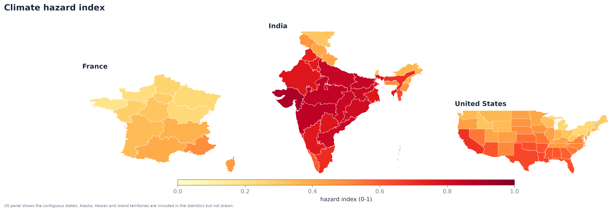

The hazard map is dominated by India. Mean hazard is 0.67 in India, 0.45 in the United States and 0.32 in France. Gujarat, Rajasthan and Madhya Pradesh combine very high heat with a strongly negative water balance - the two conditions that make agriculture fragile.

The United States shows the value of working below country level. National averages hide a west-east gradient from the hot, dry south-west to the temperate north-east, and they hide Alaska entirely, which scores high on hazard for reasons of cold-season extremes rather than heat.



### Heat exposure is overwhelmingly Indian

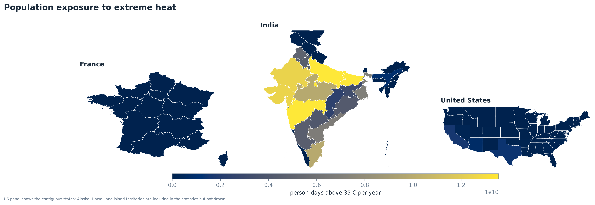

Person-days of extreme heat tell a different story from the hazard index, because they weight by population:

| Country | Regions | Population | Person-days of heat (bn/yr) | Share |
|---|---|---|---|---|
| India | 36 | 1,400M | 146.2 | 96.0% |
| USA | 56 | 339M | 5.9 | 3.9% |
| France | 13 | 64M | 0.2 | 0.1% |

India holds 96% of the pilot's heat exposure. This is not a modelling artefact: it follows directly from 1.4 billion people living in a hot climate. Uttar Pradesh alone contributes 27.5 billion person-days per year, more than the entire United States.



### Development

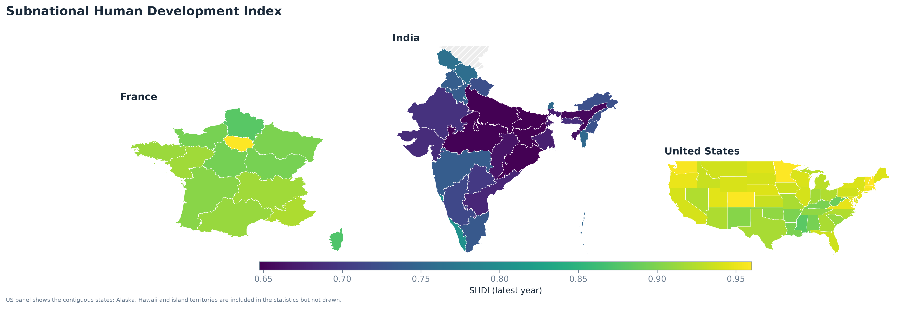

SHDI ranges from 0.614 in Bihar to 0.961 in the top US states. Within-country variation is substantial: India spans 0.61-0.81, the USA 0.88-0.96, France 0.87-0.96. The Indian range is wider than the gap between the US and French averages, which is exactly why a country-level analysis would be misleading here.

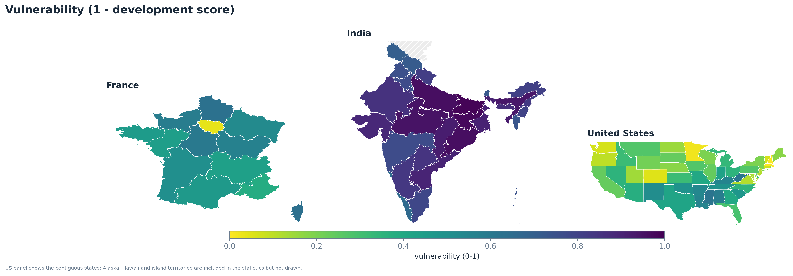

Turning development around gives the vulnerability layer. The pattern is the mirror image of the SHDI map, which is the point: vulnerability in this framework is not a separate judgement about institutions, it is the absence of the human development that makes adaptation possible.

### Composite risk

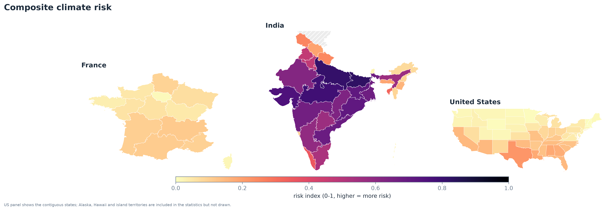

The top of the risk ranking is entirely Indian:



Bihar, Uttar Pradesh and Gujarat combine all three components. They are hot, they are populous, and they have low SHDI. The pattern is not driven by a single outlier: **all ten are Indian, and eight of them lie in the Indo-Gangetic plain, central India or the west**.

At the other end, the lowest-risk regions are French and northern US states - moderate hazard, high development - plus a few sparsely populated US regions where exposure is low despite high hazard.

### Double exposure

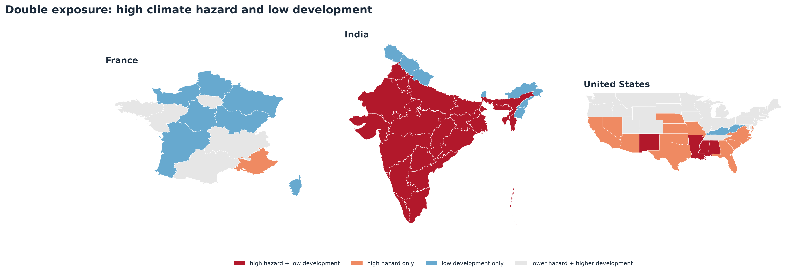

Splitting hazard and vulnerability at their medians gives the map a policy reader will actually use. The dark red group - high hazard *and* low development - is the priority group for adaptation finance. It is concentrated in India, with a few US regions, and no French region at all.

## Hypothesis tests

### H1: exposure is concentrated

Sort regions from most to least hazardous and accumulate. If exposure were spread evenly, the top 10% would hold 10% of person-days of heat. They hold **62%**, while containing **45%** of the population.

- Concentration ratio: **1.38**
- Bootstrapped 95% CI: **1.21 to 1.75**
- Interpretation: the most hazardous tenth of regions carries about 38% more heat exposure per person than its population share would predict.

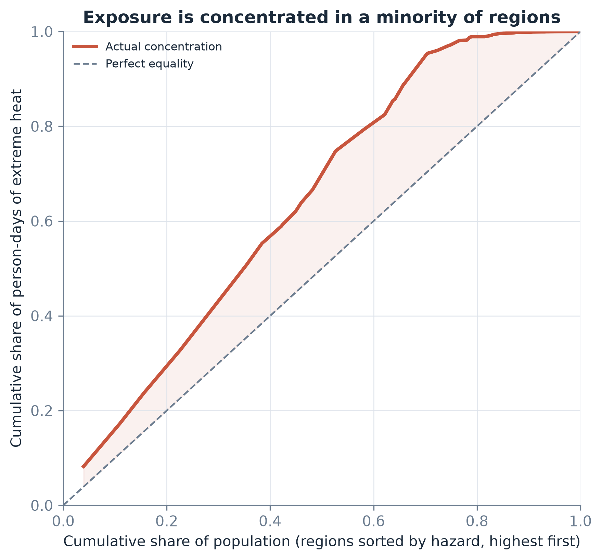

The curve bends away from the diagonal, and the confidence interval stays above 1. The concentration is real, though moderate - it is not the extreme inequality that the word "concentrated" might suggest.

### H2: high hazard goes with lower development

| Group | Regions | Median SHDI |
|---|---|---|
| Above median hazard | 49 | 0.786 |
| At or below median hazard | 50 | 0.936 |

- Mann-Whitney U = 536, **p = 1.4 × 10⁻⁶**
- Cliff's δ = **−0.56** (large: the probability that a randomly chosen high-hazard region has lower SHDI than a randomly chosen low-hazard region is about 78%)
- Spearman ρ = **−0.59** (p = 1.4 × 10⁻¹⁰)


The scatter plot shows the mechanism clearly: the cloud is not a single line, it is three separate clouds. India sits bottom-right (high hazard, low SHDI), the USA top-middle, France top-left. The overall correlation is therefore partly a *between-country* fact.



## Does the gap survive within-country comparison?

This is the report's central test. Comparing regions across countries conflates climate with everything else that differs between countries. Adding country fixed effects removes all between-country differences and asks: *within India, within the USA, within France, do hotter regions have lower development?*

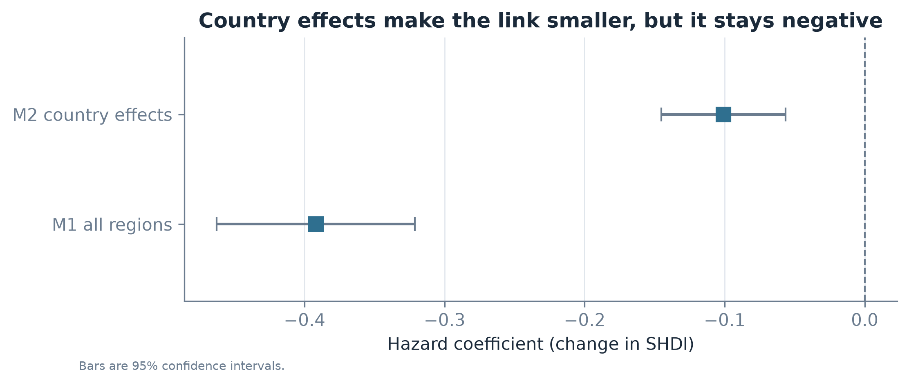

| Model | Specification | Hazard coefficient (95% CI) |
|---|---|---|
| M1 | pooled, no controls | −0.69 (−0.82 to −0.57) |
| M2 | + density, latitude, remoteness | −0.28 (−0.61 to +0.04) |
| M3 | + country fixed effects | **−0.21 (−0.31 to −0.11)** |
| M4 | hazard split into heat/dry/wet | heat −0.15, dry −0.01, wet −0.15 |

Reading the models in order is the point of the exercise:

- Without controls, hazard looks like a powerful predictor (β = −0.69).
- Adding density, latitude and remoteness removes about 60% of that association: the coefficient falls to −0.28. The confidence interval now includes zero (p = 0.09), so the controls have absorbed much of the signal and what remains is imprecise.
- Country fixed effects then give **−0.21** with a much narrower interval (p < 0.001). The estimate barely moves from M2, but it becomes far more precise, because comparing regions inside the same country removes a large source of noise.
- Splitting hazard into its three parts (M4) shows that **heat (−0.15) and extreme rainfall (−0.15) both matter**, while the dry component is indistinguishable from zero (−0.01). The wet result is worth stating carefully: "wet hazard" here means heavy one-day rainfall, that is storm and monsoon exposure, not drought.

So roughly **70% of the raw association is between-country**, and **30% survives within-country comparison**. The within-country association is smaller but not zero, and it is the part that policy can actually address.



### The within-country pattern is not uniform

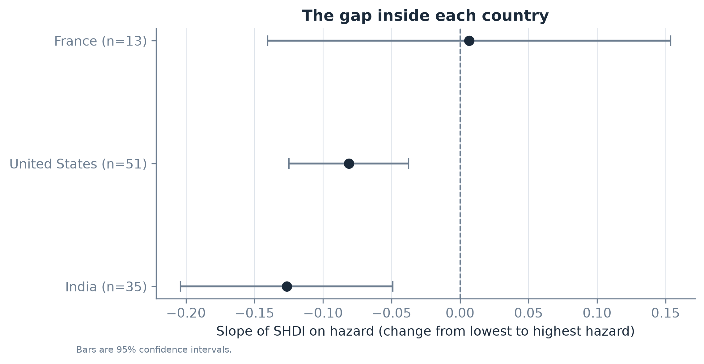

| Country | Regions | Slope | 95% CI | p |
|---|---|---|---|---|
| India | 35 | **−0.223** | −0.360 to −0.087 | 0.001 |
| USA | 51 | **−0.143** | −0.220 to −0.066 | 0.0003 |
| France | 13 | +0.012 | −0.248 to +0.271 | 0.93 |

India shows the strongest within-country gradient, the USA a moderate one, and France none at all. This is a coherent story rather than a statistical accident: in a rich temperate country, climate stress is not severe enough to shape where human development settles, and regional income differences are driven by urban systems and industrial history. In India, agricultural dependence and heat exposure are tightly linked.

France's flat slope also carries a warning about sample size. With 13 regions the confidence interval is wide enough to contain both zero and a moderate negative effect, so "no relationship in France" should be read as "not enough regions to tell".

## Spatial clustering

A correlation treats every region as independent. They are not: a drought in Rajasthan continues into Gujarat, and a poor region usually has poor neighbours. Moran's I measures whether similar values sit next to each other.

Because the three pilot countries do not share a border, a single global statistic would mostly capture "India is not France". We therefore report Moran's I **inside each country**, using Queen contiguity and dropping islands that have no land neighbours.



The numbers tell a more interesting story than "everything clusters":

- **Hazard is spatially clustered everywhere**, and most strongly in the United States (I = 0.69) and France (0.55), with India lower (0.47). All three are significant at p ≤ 0.001. The Indian value is lower because the country contains several distinct climate zones - the Himalayan north, the monsoon coast and the arid west - that sit next to each other.
- **Development clusters in the USA (0.55) and India (0.38)** but **not in France (−0.31, p = 0.07)**. France is the exception that proves the rule: rich and less rich regions alternate rather than forming one poor belt, so a low-SHDI region is often next to a high-SHDI one.
- **Composite risk clusters strongly in the USA (0.72) and France (0.59)** but only weakly in India (0.25). This is worth pausing on. India's *hazard* is spatially smooth, but risk also depends on population and development, which change sharply from one state to the next. Two neighbouring states can therefore have very different risk scores even though both are hot.
- **Exposure clusters in the USA (0.61) and France (0.51)** and barely in India (0.20), for the same reason: India's population is spread across almost the whole country, so high exposure is not confined to one corner.

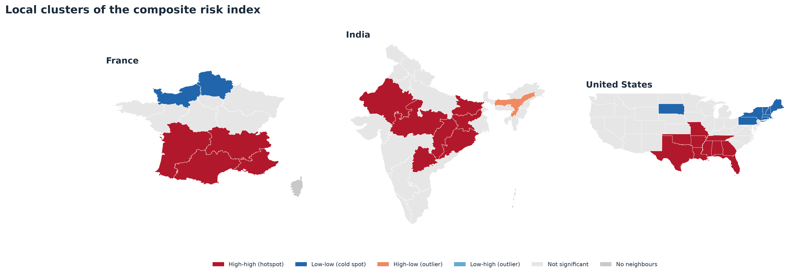

The LISA map adds something a global statistic cannot: it separates genuine clusters from outliers. Ten US regions form a significant high-high risk cluster and nine a low-low one; in India, seven regions form a high-high cluster and five a low-low development cluster. A high-risk region surrounded by low-risk neighbours (a high-low outlier, of which there is one in India) is a different policy problem from a high-risk region inside a high-risk cluster - the first may be a local anomaly, the second needs regional coordination.

::: {.callout-note}
**Why islands are dropped, not imputed.** Queen contiguity gives Hawaii, Corsica, Lakshadweep and the US territories an empty neighbour list. Assigning them an artificial neighbour would change Moran's I for reasons that have nothing to do with geography. They are excluded from the statistic and labelled "no neighbours" on the map.
:::

## Robustness

### The ranking does not depend on our weighting choices

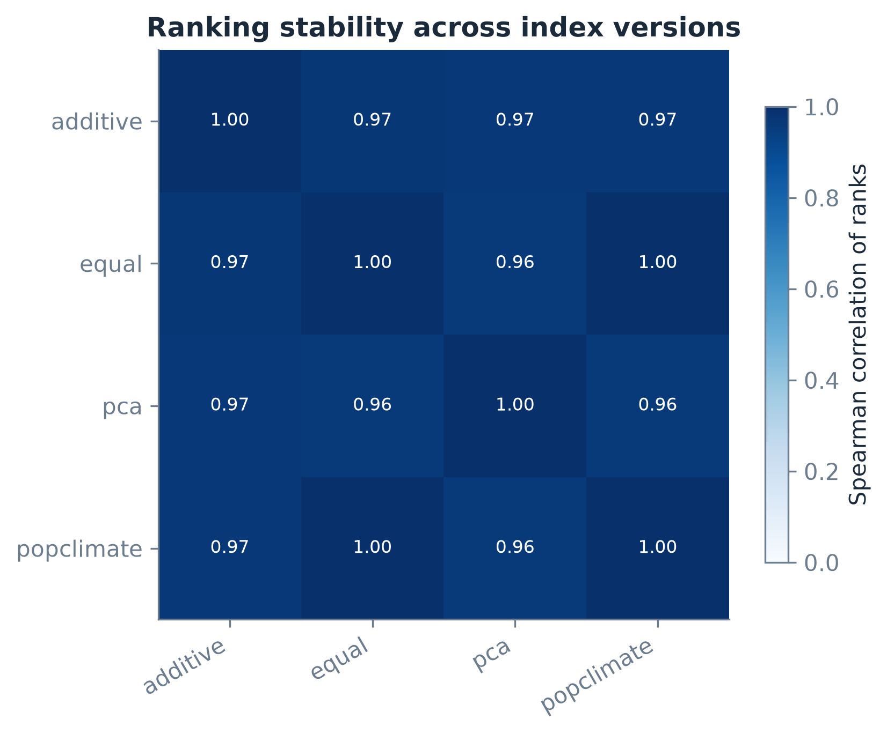

All pairwise Spearman correlations between the four index versions are **0.96 or higher**, and the top-20 overlap is high in every pair. Switching from equal weights to PCA weights, or from a product to a sum, moves individual regions by a few places but does not reshuffle the ranking.



This is the most reassuring result in the report. Index construction involves dozens of small decisions; the fact that the answer barely moves when those decisions change is evidence that the underlying signal is strong.

### What changes the answer

Three choices *do* matter:

1. **Area versus population weighting of climate.** Area-weighted hazard describes the territory; population-weighted hazard describes what people experience. They agree in most regions but diverge in countries with empty interiors (Alaska, Rajasthan's desert districts).
2. **Whether exposure enters risk at all.** Dropping exposure turns the risk index into "hazard where development is low", which moves several sparsely populated US regions up the ranking.
3. **The heat threshold.** 35 °C is a common agronomic and health threshold, but it is arbitrary. A 30 °C threshold would raise France and the northern USA; a 40 °C threshold would concentrate the index almost entirely in South Asia.

## Discussion

### What the results mean

The results support a specific and moderate claim: **climate hazard and low human development overlap, and the overlap is not only a between-country artefact.** Within India and within the United States, hotter regions have lower SHDI, and the relationship survives controls for density, latitude and remoteness.

The magnitude matters. Because both variables are standardised, a coefficient of −0.21 means that a one standard deviation increase in hazard within a country is associated with about a fifth of a standard deviation lower SHDI. Moving from the 25th to the 75th percentile of hazard is a bigger step (about 1.35 standard deviations), so it corresponds to roughly **0.28 standard deviations** of SHDI. That is meaningful but not overwhelming - climate is one factor among many, not a destiny.

### What follows for policy

- **Target regions, not countries.** The double-exposure map identifies exactly where adaptation finance has the highest expected return per person.
- **Heat is the binding constraint in South Asia.** 96% of the pilot's person-days of extreme heat are in India. Heat action plans, cool roofs, early-warning systems and occupational protections are the relevant instruments, not generic "climate finance".
- **Development *is* adaptation capacity.** Because vulnerability is measured as low SHDI, the analysis implies that health, education and income are themselves adaptation policy - a conclusion consistent with the adaptation literature.
- **Wealthy countries still have hotspots.** The US south-west appears in the high-hazard group. High national income does not protect a region whose local development is below the national average.

### Limitations

We list these honestly, because a report that hides them is less useful than one that does not.

1. **Association, not causation.** Country fixed effects control for all time-invariant national differences, but not for time-varying shocks, and they cannot rule out reverse causality - wealthier regions may adapt in ways that change measured exposure.
2. **One development indicator.** SHDI is a composite of health, education and income. It does not capture inequality *within* a region, which is often what determines who suffers in a heatwave. Subnational poverty data (World Bank SPID) would improve this and is the obvious next step.
3. **Static population.** GHS-POP 2020 is applied to a 2004-2023 climate baseline. Rapidly urbanising regions therefore carry 2020 population weights into a climate average that includes 2004.
4. **Coarse sampling in large regions.** Up to eight points per region is adequate for a state the size of Bihar and thin for Alaska. The point count scales with area, but not with climate heterogeneity.
5. **The 35 °C threshold is a choice.** It is defensible for agriculture and health, but a different threshold gives a different map.
6. **Pilot selection.** France, India and the USA were chosen to stress-test the pipeline, not to be representative of the world. The 1.38 concentration ratio will change when the pipeline is extended to all countries.
7. **Boundary vintage.** geoBoundaries polygons and GDL regions do not always match (Ladakh, the merged Dadra and Nagar Haveli and Daman and Diu). Aggregation rules are documented in the crosswalk file.

## Reproducibility

The whole pipeline runs from one command:

```bash
cro all          # every step, in order
cro validate     # data-contract checks (exits non-zero on failure)
cro export       # maps and figures
quarto render report/report.qmd
cro app          # dashboard at http://127.0.0.1:8050
```

Every intermediate table is written to `data/processed` as Parquet, so a single step can be re-run without repeating the downloads. Downloads are cached per request, which is what allowed the 308-point climate download to resume after an interruption.

The analysis loads from PostGIS when the database is running and falls back to Parquet when it is not, which means the dashboard works on a laptop with no database installed.



### What was checked

Beyond the automated contract checks, three manual sanity checks were made at each stage:

- Rajasthan has more heat days than Kerala (169 vs 0).
- The two population methods agree within 0.1%.
- The top of the risk ranking is stable across index versions (ρ ≥ 0.96).

## Files and how to navigate them

| Path | Contents |
|---|---|
| `src/cro/ingest/` | boundaries, climate, population, development downloaders |
| `src/cro/features/build.py` | hazard, exposure, vulnerability and risk construction |
| `src/cro/analysis/` | descriptives, hypothesis tests, regression, spatial statistics |
| `src/cro/viz/` | shared theme, static maps, charts, export |
| `src/cro/app/` | Plotly Dash dashboard |
| `src/cro/db/` | PostGIS schema and loader |
| `outputs/maps/` | 11 static maps + 4 interactive HTML maps |
| `outputs/figures/` | 6 statistical figures |
| `outputs/tables/` | 9 CSV tables used in this report |

### Interactive maps

Open these in any browser, no Python needed:

- `outputs/maps/map_web_risk.html` - composite risk
- `outputs/maps/map_web_hazard.html` - climate hazard
- `outputs/maps/map_web_exposure.html` - person-days of heat
- `outputs/maps/map_web_shdi.html` - subnational HDI

## Appendix: extending to the world

The pilot is built so that scaling up is a configuration change, not a rewrite. Three things change when moving from 3 countries to ~150:

1. **Sampling.** 3,700 regions at up to 8 points each implies roughly 15,000 NASA POWER requests. At 4 parallel workers and ~2 s per request that is about 2 hours, plus storage for the cache.
2. **Fixed effects.** With 150 countries, cluster-robust standard errors at the country level become reliable; the code already switches to them automatically above 20 countries.
3. **Spatial weights.** At global scale, cross-border contiguity becomes meaningful, so Moran's I can be computed once globally instead of per country.

A second extension is a forward-looking appendix at country level: downscaled projections from the Copernicus Climate Data Store (CMIP6) would allow the same index to be computed for 2050 under SSP2-4.5 and SSP5-8.5. This is deliberately kept out of the core analysis because mixing observations and projections would blur the distinction between what is measured and what is modelled.

## References

Global Data Lab. *Subnational Human Development Index (SHDI)*. Radboud University. <https://globaldatalab.org/shdi/>

IPCC (2022). *Climate Change 2022: Impacts, Adaptation and Vulnerability*. Contribution of Working Group II to the Sixth Assessment Report.

NASA Langley Research Center. *POWER Project Data Access Viewer*. <https://power.larc.nasa.gov/>

Pesaresi, M., et al. (2023). *GHS-POP R2023A - GHS population grid multitemporal (1975-2030)*. European Commission, JRC.

Runfola, D., et al. (2020). geoBoundaries: A global database of political administrative boundaries. *PLOS ONE*, 15(4), e0231866.

World Bank. *World Development Indicators*. <https://databank.worldbank.org/source/world-development-indicators>

Hargreaves, G. H., & Samani, Z. A. (1985). Reference crop evapotranspiration from temperature. *Applied Engineering in Agriculture*, 1(2), 96-99.
