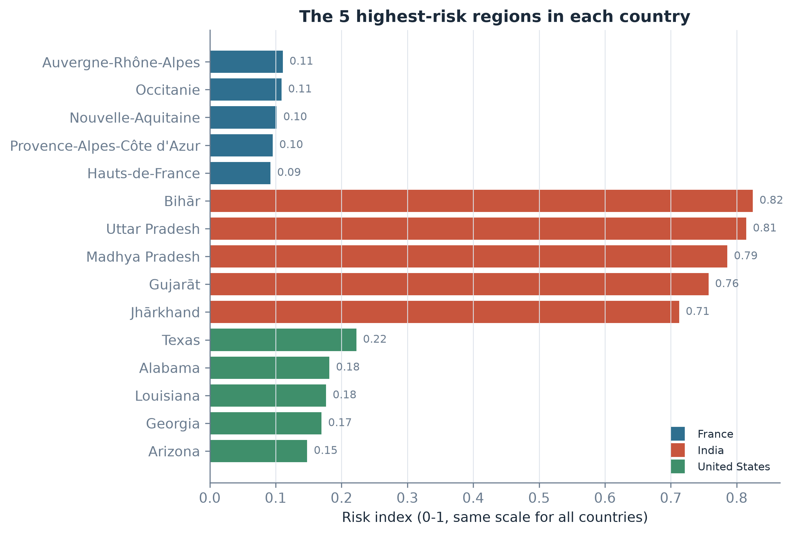
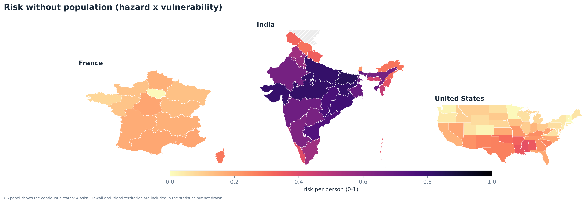
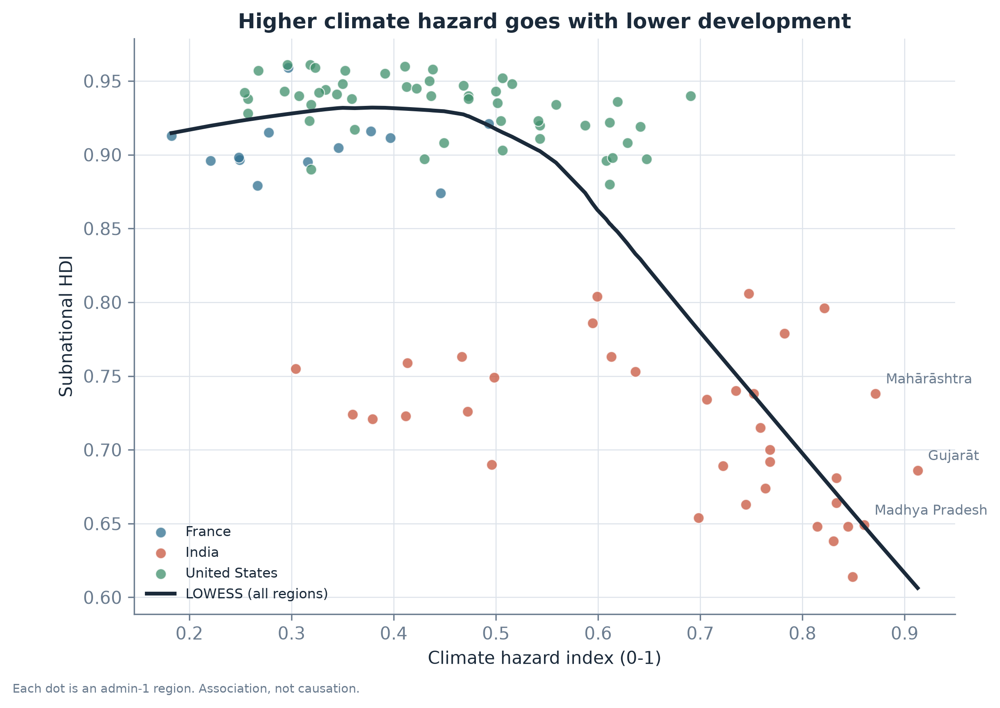

```{=html}
<style>
.callout-note { border-left: 4px solid #2f6f8f; background: #f2f7fa; padding: 10px 14px; margin: 14px 0; }
.callout-warn { border-left: 4px solid #c8553d; background: #fdf4f2; padding: 10px 14px; margin: 14px 0; }
.small { font-size: 0.9em; color: #4a5a6a; }
</style>
```


## Summary {.unnumbered}

This project asks a simple question: **are the regions with the most extreme climate also the regions with the lowest human development?** We answer it for 105 admin-1 regions (states, provinces and regions) in France, India and the United States, which together have 1.8 billion people.

We build a Python pipeline that downloads open data, computes a climate risk index for each region, tests three hypotheses, and shows the results in maps, a report and a web dashboard.

The main results are:

1. **H1 - More hazard goes with less development.** On all regions, the Spearman correlation between the climate hazard index and the Subnational Human Development Index (SHDI) is −0.59. But most of this comes from the difference between India and the two other countries.
2. **H2 - The link is weaker inside countries, but it is still there.** When we add a country effect to the regression, the hazard coefficient goes from −0.39 to −0.10. The link is clear in India and the USA, and absent in France.
3. **H3 - The ranking is stable.** Three different versions of the index give almost the same top 10. All ten highest-risk regions are in India.

These results are **associations, not causes**.



## Abbreviations {.unnumbered}

| Abbreviation | Meaning |
|---|---|
| admin-1 | first level of regions inside a country (states, provinces, regions) |
| CC-BY | Creative Commons Attribution licence (free use if the source is cited) |
| CDD | Consecutive Dry Days: longest run of days with less than 1 mm of rain |
| CI | Confidence Interval (here at 95%) |
| CRS / EPSG:4326 | Coordinate Reference System; EPSG:4326 = latitude/longitude (WGS 84) |
| CSV | Comma-Separated Values (simple table file) |
| ETCCDI | Expert Team on Climate Change Detection and Indices (standard climate extreme indices) |
| FRA, IND, USA | ISO 3-letter codes for France, India and the United States |
| GHS-POP | Global Human Settlement Layer - Population grid (European Commission) |
| H1, H2, H3 | the three hypotheses tested in this report |
| HC3 | a type of robust standard error for regressions |
| HD35 | Heat Days: days with a maximum temperature of 35 °C or more |
| IPCC | Intergovernmental Panel on Climate Change |
| INFORM | Index for Risk Management (European Commission) |
| JRC | Joint Research Centre of the European Commission |
| M1, M2 | the two regression models (without and with country effects) |
| MERRA-2 | Modern-Era Retrospective analysis for Research and Applications, version 2 (NASA climate data) |
| N | number of observations (regions) |
| NASA POWER | NASA Prediction Of Worldwide Energy Resources (daily climate data) |
| OECD | Organisation for Economic Co-operation and Development |
| OLS | Ordinary Least Squares (linear regression) |
| p | p-value: probability of a result at least this strong if there were no real link |
| R² | share of the variation of SHDI explained by the model |
| R50 | days with more than 50 mm of rain |
| Rx1day | heaviest rain in one day of the year |
| rho | Spearman rank correlation, from −1 to +1 |
| SHDI | Subnational Human Development Index (Global Data Lab) |
| TR25 | Tropical nights: nights with a minimum temperature of 25 °C or more |
| WBAL | Water Balance: rain minus evapotranspiration |
| WDI | World Development Indicators (World Bank) |

## Introduction

### Context

Climate risk is often discussed country by country. But a country is not uniform: in India, Rajasthan has about 170 days above 35 °C per year, while Kerala has almost none. Human development also changes a lot inside a country. To know where help is most needed, we need to work at a smaller scale. Earlier studies show why this matters: Nordhaus (2006) found that climate and geography explain a large part of economic output when it is measured on a fine grid instead of by country, and Dell, Jones and Olken (2009) showed that the negative link between temperature and income also exists *inside* countries. Climate shocks also hit people with fewer resources harder (Hallegatte et al., 2016), and high temperatures reduce economic production (Burke, Hsiang & Miguel, 2015).

We work at **admin-1 level** (states, provinces, regions). This is the smallest level where climate, population and development data are all available for free.

### Research question and hypotheses

> Are the regions with the most extreme climate also the regions with the lowest human development?

We test three hypotheses:

- **H1.** Regions with a higher climate hazard have a lower SHDI.
- **H2.** This is still true when we compare regions of the same country.
- **H3.** The risk ranking does not change much when we change the way the index is built.

H2 is important. India has a hotter climate and a lower average SHDI than France and the USA, so a correlation on all regions could only say "India is different". Comparing regions inside the same country is a fairer test. Economists have long debated whether the link between geography and income comes from climate itself (Gallup, Sachs & Mellinger, 1999) or from history and institutions (Acemoglu, Johnson & Robinson, 2002). Comparing regions of the same country keeps national institutions the same, which is the approach used by Dell, Jones and Olken (2009).

### Scope

The pilot covers three countries, chosen because they are very different: France (high income, temperate climate, small), the USA (high income, very large, many climates) and India (lower-middle income, hot climate, very large population). The code can run on other countries by changing one line in `config/config.yaml`.

::: {.callout-warn}
**What this report does not claim.** All results are associations. We do not prove that climate causes low development. History, geography and institutions can explain both.
:::

## Data

### Sources

| Layer | Source | Resolution | Years | Licence |
|---|---|---|---|---|
| Region boundaries | geoBoundaries (gbOpen) | admin-1 polygons | 2024 release | CC-BY 4.0 |
| Daily climate | NASA POWER (MERRA-2) | points | 1991-2023 | Open, no key |
| Population | GHS-POP R2023A | ~1 km grid | 2020 | CC-BY 4.0 |
| Development | Global Data Lab SHDI | admin-1 | latest year | Free for research |
| National context | World Bank WDI | country | 2010-2023 | CC-BY 4.0 |

### Climate data

NASA POWER gives one daily time series per point. Its data come from the MERRA-2 reanalysis of NASA (Gelaro et al., 2017). Inside each region we choose between 1 and 8 sample points (one point per 40,000 km²), spread over the whole region. This gives **308 points** in total. For each point we download every day from 1991 to 2023.

From the daily data we compute six indicators per year, then take the mean over 2004-2023. They follow the logic of the standard climate extreme indices of the ETCCDI expert team (Zhang et al., 2011), with thresholds chosen for heat stress and heavy rain:

| Code | Indicator | Group |
|---|---|---|
| HD35 | days with maximum temperature of 35 °C or more | heat |
| TR25 | nights with minimum temperature of 25 °C or more | heat |
| CDD | longest run of days with less than 1 mm of rain | dry |
| WBAL | rain minus evapotranspiration (Hargreaves formula) | dry |
| Rx1day | heaviest rain in one day | wet |
| R50 | days with more than 50 mm of rain | wet |



A quick check: Rajasthan (desert) has 169 heat days per year and Kerala (monsoon coast) has 0. This is what we expect, so the data look correct.

### Population

GHS-POP gives the number of people in each 1 km cell. We sum the cells inside each region. We also give each person to the nearest climate point. The two totals agree (1,803.1 million against 1,805.5 million, a 0.1% difference). With these two pieces we also compute *person-days of extreme heat* (people × hot days), a measure used in heat exposure studies (Tuholske et al., 2021). It is shown in Table 1 as extra information, but it is not used in the risk index.

### Development

The SHDI comes from the Global Data Lab (Smits & Permanyer, 2019). It is computed like the national Human Development Index (health, education and income), but for regions. Its region names are not always the same as in geoBoundaries (for example *Odisha* / *Orissa*). We matched names in three steps: exact match, a short manual list, then fuzzy matching. **99 of the 105 regions** have an SHDI. The 6 others (Ladakh and five small US territories) are kept on the climate maps but are not used in the tests. We do not fill them with the country average, because this would create fake data.

## Method

### The risk index

We follow the IPCC idea: risk comes from the interaction of a **hazard**, people **exposed** to it, and their **vulnerability** (Cardona et al., 2012; IPCC, 2014). Each part is a score between 0 and 1.

To build each score we use **percentile ranks**: the region with the lowest value gets a score close to 0 and the region with the highest value gets 1. Ranks let us mix days, millimetres and index points, and one extreme region does not squash all the others. Rank-based normalisation is one of the standard methods described in the OECD/JRC handbook on composite indicators (Nardo et al., 2008).

**Hazard** is the mean of three sub-scores:

```
Hazard = (H_heat + H_dry + H_wet) / 3
```

`H_heat` is the mean rank of HD35 and TR25, `H_dry` the mean rank of CDD and (reversed) WBAL, and `H_wet` the mean rank of Rx1day and R50.

**Exposure** is the rank of the region's population. We do not multiply population by heat days here, because heat is already in the hazard score: it would be counted twice.

**Vulnerability** is `1 - rank(SHDI)`. Low development means less money, health and education to face a climate shock.

**Risk** is the product of the three:

```
Risk = Hazard x Exposure x Vulnerability
```

We use a product because a region needs all three to be at risk: a hot desert with nobody living there is not a disaster. The INFORM risk index of the European Commission also combines its parts by multiplication, so that the risk is zero when one part is zero (Marin-Ferrer, Vernaccini & Poljansek, 2017).

### Three versions of the index

| Version | Formula | Why |
|---|---|---|
| `equal` (main) | Hazard × Exposure × Vulnerability | the main result |
| `additive` | mean of the three scores | does the product matter? |
| `per_person` | Hazard × Vulnerability | removes population: is the ranking only a size effect? |

Testing several versions of an index is recommended practice, because the weights and the formula are choices (Saisana, Saltelli & Tarantola, 2005; Nardo et al., 2008). The `per_person` version is useful because big regions always get a high exposure score. If the top regions stay the same without population, the ranking is not only about size.

### Statistical tests

- **H1:** Spearman rank correlation between hazard and SHDI, on all regions and then country by country. We use Spearman (1904) because it works on ranks and does not need a normal distribution. We also compare the median SHDI of the more hazardous half and the less hazardous half.
- **H2:** two linear regressions (OLS) with SHDI as the outcome:
  - M1: `SHDI = a + b x Hazard`
  - M2: the same, plus one dummy variable per country ("country effect").

  The country dummies remove the average difference between countries, so `b` in M2 only uses differences between regions of the same country. We also fit M1 in each country separately. We use robust (HC3) standard errors, which stay correct when the error variance is not the same for every region and are recommended for small samples (Long & Ervin, 2000).
- **H3:** Spearman correlation between the rankings of the three versions, and the number of regions that are in the top 10 of both versions.

We use a 5% significance level.

## Results: the maps

### Hazard


India has the highest hazard (mean 0.67), then the USA (0.45) and France (0.32). In the USA, the south and south-west are much more hazardous than the north-east.

### Exposure and development


SHDI goes from 0.614 (Bihar) to 0.961 (top US states). India goes from 0.61 to 0.81, the USA from 0.88 to 0.96 and France from 0.87 to 0.96. The differences inside India are larger than the difference between the USA and France.



### Risk




All ten highest-risk regions are in India. Bihar, Uttar Pradesh and Madhya Pradesh are hot, very populated and have a low SHDI. On this shared scale France and the USA look pale. Inside their own country, the highest-risk regions are Texas, Alabama and Louisiana in the USA, and Auvergne-Rhône-Alpes, Occitanie and Nouvelle-Aquitaine in France (see the figure below and the `rank_in_country` column).





The map without population looks very similar. Small Indian states such as Tripura move up, but the big northern and central states stay at the top.

### High hazard and low development together


We split hazard and vulnerability at their median. 33 regions are both above the median hazard and above the median vulnerability: 28 in India and 5 in the USA, none in France. These are the regions where adaptation is most urgent.

## Results: the hypotheses

### H1: more hazard, less development



On all regions, the correlation is −0.59 and very significant. The median SHDI is 0.786 in the more hazardous half and 0.936 in the other half.



The figure shows why we must be careful. The points form **three groups**: India at the bottom right, the USA and France at the top. A large part of the correlation is simply the gap between India and the other two countries. Inside each country, the correlation is smaller: −0.48 in India and in the USA (both significant), and +0.18 in France (not significant).

**H1 is supported**, but mainly because of the difference between countries.

### H2: is it still true inside countries?




How to read the coefficient: hazard goes from 0 to 1, so the coefficient is the change in SHDI from the least to the most hazardous region.

- Without country effects (M1), the coefficient is −0.39.
- With country effects (M2), it falls to **−0.10** (95% CI −0.14 to −0.06). In simple words: in the same country, +0.1 of hazard goes with about −0.01 of SHDI.

So about three quarters of the link is between countries, and one quarter remains inside countries.




The slope is negative and significant in India and the USA, and close to zero in France. France has only 13 regions and small climate differences, so we cannot conclude anything there.

**H2 is supported** for India and the USA, with a smaller effect than in H1.

### H3: is the ranking stable?




The three versions are strongly correlated (Spearman correlation of at least 0.86), and at least 9 of the top 10 regions are the same in every pair. Even the version without population keeps the same leaders, so the ranking is not only a size effect.

**H3 is supported.**

## Discussion and limitations

### What the results mean

Climate hazard and low human development overlap, mostly between countries but also inside India and the USA. The effect inside countries is moderate: climate is one factor among many. This is the same pattern as in Dell, Jones and Olken (2009): the link inside countries is real but smaller than the link between countries. For policy, this means that help should target **regions**, not whole countries, and that the regions with both high hazard and low development (map above) should come first.

### Limitations

1. **Association, not causation.** History, geography and the economy can explain both climate and development (Gallup, Sachs & Mellinger, 1999; Acemoglu, Johnson & Robinson, 2002).
2. **Neighbouring regions are similar.** The regressions treat each region as independent, but neighbours share climate and economy. So the p-values are probably too small. A spatial regression model (Anselin, 1988) would be a good next step.
3. **Only 3 countries and 99 regions.** France has only 13 regions, so its results are uncertain.
4. **One development indicator.** SHDI does not show inequality inside a region.
5. **Fixed thresholds.** 35 °C and 50 mm are choices. France has almost no days above 35 °C, so a lower threshold would change its map.
6. **Static population.** Population is for 2020, but the climate mean is for 2004-2023.
7. **Coarse sampling.** At most 8 climate points per region: enough for Bihar, thin for Alaska.

## Technical implementation

### Architecture

The project is a Python package (`cro`) with one command-line tool. Each step reads and writes Parquet files, so a step can be run again without downloading everything.

```
config/config.yaml        all settings (countries, thresholds, years)
src/cro/ingest/           download boundaries, climate, population, development
src/cro/features/build.py hazard, exposure, vulnerability, risk
src/cro/analysis/         descriptive statistics, H1/H3 tests, H2 regression
src/cro/viz/              static maps, charts, interactive maps
src/cro/db/               PostGIS schema and loader (optional)
src/cro/app/              Dash dashboard + summary and report pages (EN/FR)
src/cro/report/           report tables + Quarto rendering
tests/                    unit tests and data checks (pytest)
```

### Running the pipeline

```bash
cro all          # download, build the index, run the analysis, export the figures
cro validate     # 8 data checks (exit code 1 if one fails)
cro report       # build the report tables and render this report
cro load         # optional: copy the tables into PostGIS (docker compose up -d)
cro app          # dashboard at http://127.0.0.1:8050
```

### Quality checks

- `cro validate` checks the data: unique regions, valid geometry, population totals, physical ranges of the climate values, scores between 0 and 1, SHDI coverage and output tables.
- `pytest` runs unit tests on small hand-made examples (percentile ranks, hazard, exposure, vulnerability, Spearman test, rank comparison) and smoke tests for the dashboard.
- The report and the dashboard read their numbers from the same CSV tables, so they cannot show different values.



### Dashboard and deployment

The dashboard is built with Plotly Dash and Flask. It shows the maps, the ranking, the hazard-SHDI chart and a profile for each region, in English and French. It reads PostGIS when the database is running and Parquet files otherwise. It is deployed for free on Render.

Interactive maps (no Python needed):

- **Risk**: <https://climate-risk-observatory.onrender.com/maps/map_web_risk.html>
- **Hazard**: <https://climate-risk-observatory.onrender.com/maps/map_web_hazard.html>
- **Exposure (population)**: <https://climate-risk-observatory.onrender.com/maps/map_web_exposure.html>
- **SHDI**: <https://climate-risk-observatory.onrender.com/maps/map_web_shdi.html>

## Conclusion and next steps

The project shows that, in France, India and the USA, regions with a more extreme climate tend to have lower human development. Most of this link is between countries, but a smaller link remains inside India and the USA. The ranking of the most at-risk regions is stable when we change the index formula.

Possible next steps:

- add more countries (the code is ready, it is a change in the config file);
- use a spatial regression model to take neighbours into account;
- add a household income indicator to see inequality inside regions;
- test other heat thresholds (for example 30 °C).

## References

Acemoglu, D., Johnson, S., & Robinson, J. A. (2002). Reversal of fortune: Geography and institutions in the making of the modern world income distribution. *The Quarterly Journal of Economics*, 117(4), 1231-1294.

Anselin, L. (1988). *Spatial Econometrics: Methods and Models*. Dordrecht: Kluwer Academic Publishers.

Burke, M., Hsiang, S. M., & Miguel, E. (2015). Global non-linear effect of temperature on economic production. *Nature*, 527, 235-239.

Cardona, O. D., van Aalst, M. K., Birkmann, J., et al. (2012). Determinants of risk: exposure and vulnerability. In C. B. Field et al. (Eds.), *Managing the Risks of Extreme Events and Disasters to Advance Climate Change Adaptation* (IPCC Special Report, chapter 2, pp. 65-108). Cambridge University Press.

Dell, M., Jones, B. F., & Olken, B. A. (2009). Temperature and income: Reconciling new cross-sectional and panel estimates. *American Economic Review*, 99(2), 198-204.

Gallup, J. L., Sachs, J. D., & Mellinger, A. D. (1999). Geography and economic development. *International Regional Science Review*, 22(2), 179-232.

Gelaro, R., McCarty, W., Suárez, M. J., et al. (2017). The Modern-Era Retrospective Analysis for Research and Applications, Version 2 (MERRA-2). *Journal of Climate*, 30(14), 5419-5454.

Global Data Lab. *Subnational Human Development Index (SHDI)*. Radboud University. <https://globaldatalab.org/shdi/>

Hallegatte, S., Bangalore, M., Bonzanigo, L., et al. (2016). *Shock Waves: Managing the Impacts of Climate Change on Poverty*. Climate Change and Development Series. Washington, DC: World Bank.

Hargreaves, G. H., & Samani, Z. A. (1985). Reference crop evapotranspiration from temperature. *Applied Engineering in Agriculture*, 1(2), 96-99.

IPCC (2014). Summary for policymakers. In *Climate Change 2014: Impacts, Adaptation, and Vulnerability. Part A* (Working Group II contribution to the Fifth Assessment Report). Cambridge University Press.

IPCC (2022). *Climate Change 2022: Impacts, Adaptation and Vulnerability*. Working Group II contribution to the Sixth Assessment Report. Cambridge University Press.

Long, J. S., & Ervin, L. H. (2000). Using heteroscedasticity consistent standard errors in the linear regression model. *The American Statistician*, 54(3), 217-224.

Marin-Ferrer, M., Vernaccini, L., & Poljansek, K. (2017). *Index for Risk Management - INFORM: Concept and Methodology Report, Version 2017*. Luxembourg: Publications Office of the European Union (European Commission, Joint Research Centre).

NASA Langley Research Center. *POWER Project Data Access Viewer*. <https://power.larc.nasa.gov/>

Nardo, M., Saisana, M., Saltelli, A., Tarantola, S., Hoffman, A., & Giovannini, E. (2008). *Handbook on Constructing Composite Indicators: Methodology and User Guide*. Paris: OECD Publishing (with the European Commission, Joint Research Centre).

Nordhaus, W. D. (2006). Geography and macroeconomics: New data and new findings. *Proceedings of the National Academy of Sciences*, 103(10), 3510-3517.

Pesaresi, M., et al. (2023). *GHS-POP R2023A - GHS population grid multitemporal (1975-2030)*. European Commission, JRC.

Runfola, D., et al. (2020). geoBoundaries: A global database of political administrative boundaries. *PLOS ONE*, 15(4), e0231866.

Saisana, M., Saltelli, A., & Tarantola, S. (2005). Uncertainty and sensitivity analysis techniques as tools for the quality assessment of composite indicators. *Journal of the Royal Statistical Society: Series A*, 168(2), 307-323.

Smits, J., & Permanyer, I. (2019). The Subnational Human Development Database. *Scientific Data*, 6, 190038.

Spearman, C. (1904). The proof and measurement of association between two things. *The American Journal of Psychology*, 15(1), 72-101.

Tuholske, C., Caylor, K., Funk, C., et al. (2021). Global urban population exposure to extreme heat. *Proceedings of the National Academy of Sciences*, 118(41), e2024792118.

World Bank. *World Development Indicators*. <https://databank.worldbank.org/source/world-development-indicators>

Zhang, X., Alexander, L., Hegerl, G. C., et al. (2011). Indices for monitoring changes in extremes based on daily temperature and precipitation data. *WIREs Climate Change*, 2(6), 851-870.
